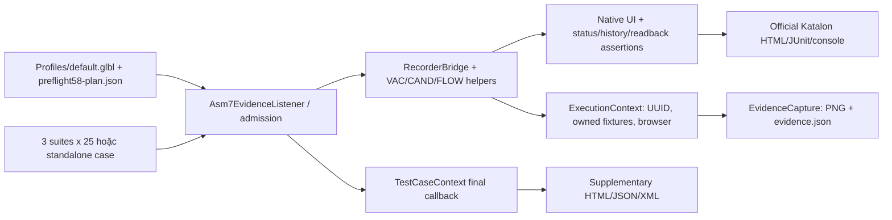

# ASM8 — Nguồn nội dung PowerPoint phần Recruitment

MSSV **23130299** — **Nguyễn Văn Thắng**. Ngày đối chiếu: **02/11/2026**, múi giờ Asia/Saigon. Phạm vi là project Recruitment cá nhân. Tài liệu này là nguồn Markdown; không phải file PPTX, không phải official Katalon report.

**PROPOSED OUTLINE — PENDING GROUP TEMPLATE CONFIRMATION.** Không tìm thấy template chính thức định nghĩa 8 phần trong project, handoff, tài liệu nhóm đã đọc. Dùng đúng 8 phần đề xuất trong yêu cầu của người dùng. Có thể chia thành khoảng 15–18 slide, vẫn giữ 8 nhóm nội dung. Không gọi dàn ý này là template đã được nhóm trưởng duyệt. [Phạm vi tìm template](<maintenance/asm8-full-audit-20261102/template-search.json>).

**Dữ liệu latest đã đối chiếu từng case giữa HTML/JUnit: 71 PASSED, 0 FAILED, 3 ERROR, 1 SKIPPED, 0 UNVERIFIED trên 75 case.** Đây là tổng của ba execution riêng, khác thời điểm; không phải một execution tích hợp ASM8. Hợp historically PASSED distinct là 72/75; không dùng 72 làm latest PASSED. Recruitment vẫn giữ quyết định Skipped trong lượt tích hợp nhóm; **ASM8_INTEGRATION_NOT_VERIFIED**, **ASM8_INTEGRATION_DEFERRED**. Thay đổi source hiện tại **BROWSER NOT VERIFIED**; browser results đã có trước sửa vẫn được ghi đúng bên dưới.

## Phần 1 — Thông tin sinh viên và đề tài

**Gợi ý slide 1: “Kiểm thử tự động Recruitment — OrangeHRM”. Nội dung copy vào PowerPoint:** Nguyễn Văn Thắng — MSSV 23130299; thành viên nhóm 01 phụ trách Recruitment. Công cụ Katalon Studio 11.6.0. Phần việc gồm Vacancies, Candidates và Recruitment Workflow, tổng 75 test case và 3 suite. Bối cảnh ASM8: chuẩn bị mã nguồn, minh chứng, báo cáo và nội dung trình bày để bàn giao; tích hợp nhóm chưa được xác nhận.

**Thuyết minh:** Vai trò cá nhân là thiết kế/hiện thực test, chuẩn bị fixture độc lập, kiểm tra assertion và đối chiếu kết quả thực tế. Không nhận kết quả của thành viên khác là công việc cá nhân. Tên `.prj` vẫn chứa VAC do lịch sử project, nhưng cấu trúc hiện có đủ ba module.

**Minh chứng và nguồn:** [Project .prj](<OrangeHRM_RECRUIT_VAC_KatalonStudio.prj>); [3 suite](<Test Suites>); bảng execution ở Phần 6. Slide mở đầu dùng tên và module, không chèn credentials, session ID, local debugger address hoặc đường dẫn máy cá nhân.

**Chưa chứng minh:** không có biên bản/report tích hợp ASM8 chung chứng nhận Recruitment được chấp nhận; chưa có PPTX cuối cùng.

## Phần 2 — Mục tiêu và phạm vi kiểm thử

**Gợi ý slide 2–3: “Mục tiêu” và “Phạm vi 75 case”. Nội dung copy:** Kiểm tra tạo/sửa/tìm/lọc Vacancy; tạo/xác minh Candidate, CV và điều kiện nhập liệu; kiểm tra Shortlist/Reject/Schedule Interview, lựa chọn Interviewer, trạng thái và lịch sử. Mỗi module 25 case. Giữ kết quả âm tính đúng oracle; không cố ép 75/75 PASSED.

**Thuyết minh:** Test positive xác minh dữ liệu lưu và mở lại; negative xác minh required/biên/định dạng và không chuyển trạng thái khi dữ liệu không hợp lệ. Metadata thiết kế `CaseDesign.json` ghi 53 Positive và 22 Negative; đây là nhãn thiết kế, không phải kết quả chạy. Không thay workbook hoặc Expected Results để hợp thức hóa lỗi UI.


| Phân hệ | Phạm vi nhóm hành động theo ID thực | Số case |
|---|---|---|
| VAC | Create: 14; Update: 3; Search: 3; Filter: 2; Reset: 1; CancelCreate: 1; CancelUpdate: 1 | 25 |
| CAND | Create: 12; UploadCV: 5; Filter: 3; Search: 1; Reset: 1; Update: 1; CancelUpdate: 1; VerifyDetails: 1 | 25 |
| FLOW | Status: 2; Shortlist: 1; Reject: 2; CancelShortlist: 1; ScheduleInterview: 7; SelectInterviewer: 3; ValidateAction: 3; CancelReject: 1; VerifyDetails: 1; History: 4 | 25 |


**Ngoài scope:** tự sửa server/demo, thay dữ liệu của người khác, tạo Employee tùy ý, bypass authentication, replay uncertain Save, ghi đè evidence lịch sử và thay quyết định integration Skipped. Hành vi native autocomplete phải xác minh numeric identity; A/B phải khác nhau.

**Minh chứng/nguồn:** [CaseDesign.json](<CaseDesign.json>), [Snapshot Expected Results runtime](<maintenance/workbook75-current.json>), [Bảng cấu trúc 75 case](<maintenance/asm8-full-audit-20261102/structure-detailed.json>). **Chưa chứng minh:** dependency dữ liệu demo còn hợp lệ ở lần chạy tương lai; bảy khác biệt giữa CaseDesign và snapshot dùng ở runtime được giữ nguyên và liệt kê ở Phần 7.

## Phần 3 — Kiến trúc project và môi trường

**Gợi ý slide 4–5: “Kiến trúc Katalon” và “Preflight/fixture isolation”. Nội dung copy:** 75 `.tc` +75 Groovy scripts →24 recruitment keywords →1 lifecycle listener.3 suite ×25 chạy tuần tự bên trong mỗi suite. Profile và preflight plan được nạp theo project directory; runtime/evidence tách theo execution UUID và case-run UUID. Login thủ công trong browser do execution sở hữu.



**Thuyết minh:** `ExecutionContext` giữ ownership và ledger prepared/submitted/observed/identified/verified/uncertain. Numeric URL/toast không đủ chứng minh persist. `ExecutionBrowser` chỉ dùng driver do execution sở hữu, Chrome profile riêng; không dùng Chrome cá nhân. `AtomicFiles` tránh overwrite. `PortablePaths` ưu tiên dedicated absolute `ASM7_EVIDENCE_ROOT`; fallback standalone là `project/evidence/executions/23130299`. Khi project đặt đúng `automation/23130299/KatalonStudio` dưới repo, fallback dùng namespace 23130299 của repo. Relative `asm7OutputDir` resolve từ project, không từ shell cwd.


| Dependency | Trạng thái hiện tại | Ý nghĩa |
|---|---|---|
| Profiles/default.glbl | PRESENT / XML hợp lệ / đang dùng | Không credentials; PIM fixture creation=false; cvLimitBytes=0L giữ blocker |
| maintenance/preflight 58-plan.json | PRESENT /75 mappings / script SHA khớp | ConfigurationPreflight đọc trước case; thiếu file phải dừng |
| maintenance/workbook 75-current.json | PRESENT /75 steps+expected | EvidenceCapture đọc để ghi Expected; khớp 75 dòng module của source-aligned workbook |
| Katalon/Groovy/Selenium | 11.6.0 /3.0.25 /4.46.0 | Katalon .prj, installed compiler và log Selenium |
| Browser/OS/Java trong latest reports | Chrome 156.0.8078.79 / Windows 11 64 bit / Java 21.0.12 | Môi trường các execution đã chạy, không cam kết môi trường máy người nhận |
| Audit/ | MISSING | Không tạo thư mục giả; audit hiện tại nằm trong maintenance |
| Git local Downloads | Không có .git | Repository nhóm được kiểm tra read-only; GIT SYNC PENDING |


Inventory đã duyệt đệ quy **18,173 file nhìn thấy được**, hash **9,365 file quan trọng đọc được**;425 directory enumeration errors đều thuộc Chrome profiles. **PARTIAL_ENUMERATION** cho vùng private browser profile; không tuyên bố đã đọc mọi cache/session file. Không đọc nội dung nhị phân hàng nghìn PNG. Đã kiểm tra SHA của 288 screenshot liên kết với 75 latest cases và xem trực tiếp ảnh tiêu biểu/lỗi. [Inventory từng file](<maintenance/asm8-full-audit-20261102/inventory.jsonl>) · [Tóm tắt coverage](<maintenance/asm8-full-audit-20261102/inventory-summary.json>).

**Chưa chứng minh:** không có test browser sau sửa; không xác minh provider/server/live employee trong lượt audit. Generated `bin`, `Libs`, `.classpath`, `.project` không phải nguồn minh chứng thành công; Studio có thể tái tạo.

## Phần 4 — Thiết kế test case và test suite

**Gợi ý slide 6–7: “Coverage” và “Oracle/fixture contract”. Nội dung copy:** 3 suite chuẩn,25 links bật chạy/suite, thứ tự khớp CaseDesign. Mỗi ID có đúng 1 script,1 `.tc`; preflight plan lưu đúng path và SHA script. Fixture tự thiết lập theo case và execution; chạy standalone không được mượn fixture case trước. Cùng execution có thể dùng các numeric employee đã được xác minh, nhưng Candidate/Vacancy phải owned riêng.

**Thuyết minh:** Sự độc lập là về fixture contract và cấu hình, không có nghĩa mọi standalone browser case đã được chứng minh riêng sau sửa. Listener khởi tạo context lazy cho standalone và finalize khi kết thúc; suite context giữ suốt 25 case. Các suite có `numberOfRerun=0`, `maxConcurrentInstances=1`. Không bật automatic rerun để replay business writes. Shared suite của nhóm cần nhóm trưởng tích hợp và chạy riêng.


| Ví dụ ID thực | Nội dung oracle đang dùng | Bằng chứng thiết kế |
|---|---|---|
| RECRUIT_VAC_Create_01 | Lưu thành công; hiển thị đúng tên, Job Title, Hiring Manager, Positions=1. | Script + runtime workbook snapshot |
| RECRUIT_CAND_UploadCV_04 | File Resume > maxFileSize (byte) bị từ chối bằng validation của file-upload; không lưu attachment quá giới hạn. Phải xác minh maxFileSize thực tế trước khi chạy test biên. | Boundary cần exact cvLimitBytes; hiện SKIPPED |
| RECRUIT_FLOW_SelectInterviewer_02 | Lưu đúng cả hai interviewer, không trùng; hiển thị đúng trên chi tiết. | Hai interviewer phân biệt; native add field + native autocomplete |
| RECRUIT_FLOW_History_04 | Có event Interview Scheduled; chi tiết trùng dữ liệu lịch đã lưu và đúng candidate. | Persisted status/history oracle, không chỉ toast |


**Nguồn:** 75 scripts và 75 `.tc`; ba file `.ts`; [preflight plan](<maintenance/preflight58-plan.json>); source-aligned workbook được đọc ngoài project và chỉ lưu filename/SHA trong audit, không copy hay sửa workbook. Runtime snapshot khớp 75/75 steps/Expected Results của ba module trong workbook nguồn đó.

**Chưa chứng minh/reference drift:** `CaseDesign.json` khác runtime Expected Results tại 7 ID;25 VAC `.tc` chỉ có mô tả generic và không nhúng Expected. Không sửa các file protected. Audit tách **source cardinality/order/plan PASS** khỏi **reference consistency PARTIAL**; initial strict `structure.json` FAIL được giữ để không che phát hiện.

## Phần 5 — Quy trình thực thi và minh chứng

**Gợi ý slide 8–10: “Cách chạy”, “First run/retest” và “Chọn minh chứng”. Nội dung copy:** Mở `.prj` trong Katalon 11.6.0; giữ profile+plan+workbook snapshot. Xác nhận Job Title và numeric employee prerequisites; không bật PIM creation hoặc đoán CV limit. Chạy case/suite trong browser owned; giữ official HTML/JUnit/console cùng supplementary outputs. Mỗi execution UUID mới là một lượt riêng.

**Quy trình operator, không phải các lệnh đã chạy live trong task:**

1. Trước khi khởi động Katalon, đặt `ASM8_RUN_KIND=FIRST_RUN` hoặc `RETEST` theo đúng ý định của lượt chạy. Nếu không đặt, report phải là `UNCLASSIFIED`; không đổi nhãn report lịch sử bằng suy luận timestamp.
2. Có thể đặt `ASM7_EVIDENCE_ROOT` tới dedicated absolute output root hoặc dùng fallback portable. Không dùng path của thành viên khác, không chép Chrome profile/cache từ máy cũ.
3. Mở case từ Test Cases hoặc một suite từ Test Suites. Katalon sẽ tạo execution UUID và case-run UUID mới. Login thủ công; không lưu credentials trong profile.
4. Sau kết thúc, giữ trọn leaf report folder và thư mục evidence UUID. Nếu bị hard-stop, giữ context/ledger nhưng dùng PARTIAL/UNVERIFIED khi không có final callback.
5. Mở index hiện tại; đối chiếu final result, log và ảnh. Screenshot `ERROR`/`STOPPED` chỉ mô tả checkpoint, không thay final status.

Ví dụ cấu hình PowerShell trước khi tự chạy:

```powershell
$env:ASM8_RUN_KIND = 'RETEST'
# ASM7_EVIDENCE_ROOT là tùy chọn; dùng dedicated absolute directory nếu cần.
# Không khởi động browser hoặc suite bằng lệnh trong tài liệu audit này.
```

**Vị trí report thật:**

| Module | Report HTML / JUnit | Console / execution log | Supplementary JSON / HTML / XML |
|---|---|---|---|
| VAC | [HTML](<Reports/20261101_142618/RECRUIT_VAC_25_ASC_001_TO_025/20261101_142618/20261101_142618.html>) · [JUnit](<Reports/20261101_142618/RECRUIT_VAC_25_ASC_001_TO_025/20261101_142618/JUnit_Report.xml>) | [console 0.log](<Reports/20261101_142618/RECRUIT_VAC_25_ASC_001_TO_025/20261101_142618/console0.log>) · [execution 0.log](<Reports/20261101_142618/RECRUIT_VAC_25_ASC_001_TO_025/20261101_142618/execution0.log>) | [results.json](<evidence/executions/23130299/RECRUIT_VAC_54fe3380-9fc/reports/UNCLASSIFIED/results.json>) · [results.html](<evidence/executions/23130299/RECRUIT_VAC_54fe3380-9fc/reports/UNCLASSIFIED/results.html>) · [results.xml](<evidence/executions/23130299/RECRUIT_VAC_54fe3380-9fc/reports/UNCLASSIFIED/results.xml>) |
| CAND | [HTML](<Reports/20261101_213459/RECRUIT_CAND_25_ASC_001_TO_025/20261101_213500/20261101_213500.html>) · [JUnit](<Reports/20261101_213459/RECRUIT_CAND_25_ASC_001_TO_025/20261101_213500/JUnit_Report.xml>) | [console 0.log](<Reports/20261101_213459/RECRUIT_CAND_25_ASC_001_TO_025/20261101_213500/console0.log>) · [execution 0.log](<Reports/20261101_213459/RECRUIT_CAND_25_ASC_001_TO_025/20261101_213500/execution0.log>) | [results.json](<evidence/executions/23130299/RECRUIT_CAND_0532d310-60a/reports/UNCLASSIFIED/results.json>) · [results.html](<evidence/executions/23130299/RECRUIT_CAND_0532d310-60a/reports/UNCLASSIFIED/results.html>) · [results.xml](<evidence/executions/23130299/RECRUIT_CAND_0532d310-60a/reports/UNCLASSIFIED/results.xml>) |
| FLOW | [HTML](<Reports/20261102_011834/RECRUIT_FLOW_25_ASC_001_TO_025/20261102_011836/20261102_011836.html>) · [JUnit](<Reports/20261102_011834/RECRUIT_FLOW_25_ASC_001_TO_025/20261102_011836/JUnit_Report.xml>) | [console 0.log](<Reports/20261102_011834/RECRUIT_FLOW_25_ASC_001_TO_025/20261102_011836/console0.log>) · [execution 0.log](<Reports/20261102_011834/RECRUIT_FLOW_25_ASC_001_TO_025/20261102_011836/execution0.log>) | [results.json](<evidence/executions/23130299/RECRUIT_FLOW_40b57a16-e34/reports/UNCLASSIFIED/results.json>) · [results.html](<evidence/executions/23130299/RECRUIT_FLOW_40b57a16-e34/reports/UNCLASSIFIED/results.html>) · [results.xml](<evidence/executions/23130299/RECRUIT_FLOW_40b57a16-e34/reports/UNCLASSIFIED/results.xml>) |


Ba supplementary report đều là **KATALON_CALLBACK_DERIVED**,25 final results/module khớp official HTML/JUnit; đã có sẵn HTML/JSON/XML và lifecycle log. Audit chỉ thêm index; không tái tạo JUnit hoặc đổi report gốc. `execution.log` supplementary là lifecycle log, không thay full Katalon console. Tất cả ba latest reports hiện có `runKind=UNCLASSIFIED`; đây là **REPORTING/PROCESS GAP** về nhãn first run/retest, dù UUID/folder đã tách riêng.

**Chọn hình thật cho slide:**

- `RECRUIT_VAC_Create_01` — Vacancy mở lại sau lưu: QA Engineer, Manager, Positions=1. Execution `54fe3380-9fcc-4fb6-8ce8-6aad4a471383`. [Ảnh gốc](<evidence/executions/23130299/RECRUIT_VAC_54fe3380-9fc/RECRUIT_VAC_Create_01/ref8777ee/142746_004_RESULT.png>); đối chiếu final PASSED ở Appendix A.

- `RECRUIT_CAND_VerifyDetails_01` — Candidate Profile mở lại, Application Initiated. Execution `0532d310-60ab-4317-9cb7-e92005fefa11`. [Ảnh gốc](<evidence/executions/23130299/RECRUIT_CAND_0532d310-60a/RECRUIT_CAND_VerifyDetails_01/r102ebc41/221802_004_RESULT.png>); đối chiếu final PASSED ở Appendix A.

- `RECRUIT_FLOW_History_04` — Profile Interview Scheduled; ghép log/history để chứng minh oracle History. Execution `40b57a16-e348-43e4-a6b9-e3d00bb8bf9e`. [Ảnh gốc](<evidence/executions/23130299/RECRUIT_FLOW_40b57a16-e34/RECRUIT_FLOW_History_04/r07d336b4/022917_003_RESULT.png>); đối chiếu final PASSED ở Appendix A.

Ảnh `History_04` chọn ở trên thể hiện Profile Interview Scheduled; nếu trình bày riêng assertion history, dùng thêm history GET/events trong console/ledger, không gọi ảnh Profile là ảnh bảng History. Không tạo ảnh giả để minh họa. Phần 7 dùng ảnh lỗi gốc; Appendix F ghi đầy đủ nguồn.

**Chưa chứng minh:** một lần Katalon standalone trên máy khác, browser sau one-byte fix, first-run/retest label của execution đã chạy và ASM8 shared integration. Các test temp-directory chỉ chứng minh quyết định path và report lifecycle offline.

## Phần 6 — Kết quả kiểm thử thực tế

**Gợi ý slide 11–12: “Latest results” và “Diễn biến các lượt chạy”. Nội dung copy:** Latest VAC 24/25 PASSED; CAND 24/25 PASSED và 1 SKIPPED; FLOW 23/25 PASSED và 2 ERROR. Tổng 71 PASSED/75 =94,67%;0 FAILED,3 ERROR,1 SKIPPED. Kết quả có provenance HTML/JUnit; không cộng historical pass để thay latest status.


| Module | Execution UUID runtime | Total | PASSED | FAILED | ERROR | SKIPPED | UNVERIFIED |
|---|---|---|---|---|---|---|---|
| VAC | 54fe3380-9fcc-4fb6-8ce8-6aad4a471383 | 25 | 24 | 0 | 1 | 0 | 0 |
| CAND | 0532d310-60ab-4317-9cb7-e92005fefa11 | 25 | 24 | 0 | 0 | 1 | 0 |
| FLOW | 40b57a16-e348-43e4-a6b9-e3d00bb8bf9e | 25 | 23 | 0 | 2 | 0 | 0 |
| TOTAL — 3 execution riêng |  | 75 | 71 | 0 | 3 | 1 | 0 |


| Module/mẫu số | PASSED | ERROR | SKIPPED | Tỷ lệ PASSED |
|---|---|---|---|---|
| VAC/25 | 24 | 1 | 0 | 96.00% |
| CAND/25 | 24 | 0 | 1 | 96.00% |
| FLOW/25 | 23 | 2 | 0 | 92.00% |
| Tổng latest/75 | 71 | 3 | 1 | 94,67% |


Mẫu số 75 là 75 final entries trong ba suite gần nhất; không phải tổng tất cả lần chạy. Tỷ lệ ERROR=3/75=4,00%; SKIPPED=1/75=1,33%; FAILED=0/75=0%. Historically PASSED distinct 72/75=96,00% là hợp tập ID qua reports còn có và locks, **không phải pass rate của một execution**. `Status_01` từng PASSED nhưng latest ERROR; `_02` vẫn ERROR. Không có case thiếu final entry trong ba latest executions.

**Biểu đồ có thể đưa vào PowerPoint:** [SVG biểu đồ số liệu latest](<maintenance/asm8-full-audit-20261102/latest-results.svg>) và [CSV dữ liệu biểu đồ](<maintenance/asm8-full-audit-20261102/latest-results.csv>). Đây là visualization dữ liệu report, không phải screenshot test.


| Module | Timestamp | Runtime UUID | P/F/E/S/U | Nguồn |
|---|---|---|---|---|
| FLOW | 20261030_184615 | b9e00999-d927-49e0-b57b-bb39f54cd3d4 | 1/0/23/1/0 | [HTML](<Reports/20261030_184615/RECRUIT_FLOW_25_ASC_001_TO_025/20261030_184615/20261030_184615.html>) · [JUnit](<Reports/20261030_184615/RECRUIT_FLOW_25_ASC_001_TO_025/20261030_184615/JUnit_Report.xml>) |
| VAC | 20261101_114617 | dd8effdd-a1e3-4c25-91c4-05c974c4f919 | 24/0/1/0/0 | [HTML](<Reports/20261101_114614/RECRUIT_VAC_25_ASC_001_TO_025/20261101_114617/20261101_114617.html>) · [JUnit](<Reports/20261101_114614/RECRUIT_VAC_25_ASC_001_TO_025/20261101_114617/JUnit_Report.xml>) |
| CAND | 20261101_120620 | e97c1057-58ca-44ae-893a-a1a190366dde | 20/0/4/1/0 | [HTML](<Reports/20261101_120620/RECRUIT_CAND_25_ASC_001_TO_025/20261101_120620/20261101_120620.html>) · [JUnit](<Reports/20261101_120620/RECRUIT_CAND_25_ASC_001_TO_025/20261101_120620/JUnit_Report.xml>) |
| FLOW | 20261101_124623 | 66a3b689-61b7-4474-8a16-647af7e3ea23 | 5/0/20/0/0 | [HTML](<Reports/20261101_124623/RECRUIT_FLOW_25_ASC_001_TO_025/20261101_124623/20261101_124623.html>) · [JUnit](<Reports/20261101_124623/RECRUIT_FLOW_25_ASC_001_TO_025/20261101_124623/JUnit_Report.xml>) |
| VAC | 20261101_140513 | 7b68409a-3e5b-4f2b-bf91-f027b6fddfe5 | 20/0/5/0/0 | [HTML](<Reports/20261101_140511/RECRUIT_VAC_25_ASC_001_TO_025/20261101_140513/20261101_140513.html>) · [JUnit](<Reports/20261101_140511/RECRUIT_VAC_25_ASC_001_TO_025/20261101_140513/JUnit_Report.xml>) |
| CAND | 20261101_140520 | d1086f87-058b-4260-ad51-b664d2a7ebe2 | 10/0/14/1/0 | [HTML](<Reports/20261101_140520/RECRUIT_CAND_25_ASC_001_TO_025/20261101_140520/20261101_140520.html>) · [JUnit](<Reports/20261101_140520/RECRUIT_CAND_25_ASC_001_TO_025/20261101_140520/JUnit_Report.xml>) |
| FLOW | 20261101_140525 | bfcbacfb-e09a-4c77-8cfb-2e36ce7b103d | 5/0/20/0/0 | [HTML](<Reports/20261101_140525/RECRUIT_FLOW_25_ASC_001_TO_025/20261101_140525/20261101_140525.html>) · [JUnit](<Reports/20261101_140525/RECRUIT_FLOW_25_ASC_001_TO_025/20261101_140525/JUnit_Report.xml>) |
| VAC | 20261101_142618 | 54fe3380-9fcc-4fb6-8ce8-6aad4a471383 | 24/0/1/0/0 | [HTML](<Reports/20261101_142618/RECRUIT_VAC_25_ASC_001_TO_025/20261101_142618/20261101_142618.html>) · [JUnit](<Reports/20261101_142618/RECRUIT_VAC_25_ASC_001_TO_025/20261101_142618/JUnit_Report.xml>) |
| CAND | 20261101_144815 | 29c6c6aa-b32e-4127-9928-5345f56ece1f | 7/0/17/1/0 | [HTML](<Reports/20261101_144815/RECRUIT_CAND_25_ASC_001_TO_025/20261101_144815/20261101_144815.html>) · [JUnit](<Reports/20261101_144815/RECRUIT_CAND_25_ASC_001_TO_025/20261101_144815/JUnit_Report.xml>) |
| CAND | 20261101_160923 | a3d28ae2-49be-428c-a768-e23b72fcc975 | 17/0/7/1/0 | [HTML](<Reports/20261101_160922/RECRUIT_CAND_25_ASC_001_TO_025/20261101_160923/20261101_160923.html>) · [JUnit](<Reports/20261101_160922/RECRUIT_CAND_25_ASC_001_TO_025/20261101_160923/JUnit_Report.xml>) |
| CAND | 20261101_174225 | eee53e27-cf6f-46dd-ad34-1aa3634460b7 | 7/0/17/1/0 | [HTML](<Reports/20261101_174224/RECRUIT_CAND_25_ASC_001_TO_025/20261101_174225/20261101_174225.html>) · [JUnit](<Reports/20261101_174224/RECRUIT_CAND_25_ASC_001_TO_025/20261101_174225/JUnit_Report.xml>) |
| CAND | 20261101_213500 | 0532d310-60ab-4317-9cb7-e92005fefa11 | 24/0/0/1/0 | [HTML](<Reports/20261101_213459/RECRUIT_CAND_25_ASC_001_TO_025/20261101_213500/20261101_213500.html>) · [JUnit](<Reports/20261101_213459/RECRUIT_CAND_25_ASC_001_TO_025/20261101_213500/JUnit_Report.xml>) |
| FLOW | 20261101_222910 | 452c6c25-c380-4773-a609-f0c0293bbc95 | 10/0/15/0/0 | [HTML](<Reports/20261101_222910/RECRUIT_FLOW_25_ASC_001_TO_025/20261101_222910/20261101_222910.html>) · [JUnit](<Reports/20261101_222910/RECRUIT_FLOW_25_ASC_001_TO_025/20261101_222910/JUnit_Report.xml>) |
| FLOW | 20261102_001246 | 06f91af5-4371-4b34-b016-d7e8f9540a5c | 13/0/12/0/0 | [HTML](<Reports/20261102_001245/RECRUIT_FLOW_25_ASC_001_TO_025/20261102_001246/20261102_001246.html>) · [JUnit](<Reports/20261102_001245/RECRUIT_FLOW_25_ASC_001_TO_025/20261102_001246/JUnit_Report.xml>) |
| FLOW | 20261102_011836 | 40b57a16-e348-43e4-a6b9-e3d00bb8bf9e | 23/0/2/0/0 | [HTML](<Reports/20261102_011834/RECRUIT_FLOW_25_ASC_001_TO_025/20261102_011836/20261102_011836.html>) · [JUnit](<Reports/20261102_011834/RECRUIT_FLOW_25_ASC_001_TO_025/20261102_011836/JUnit_Report.xml>) |


**Thuyết minh:** FLOW 001246 từng 13 P/12 E do shared PIM 422; FLOW 011836 hiện 23 P/2 E với hai timeout khác. Không mang nguyên nhân 422 cũ sang latest. CAND/VAC dates cũ hơn FLOW nhưng là latest theo từng module trong cây Reports đã kiểm tra. UUID runtime và `execution.uuid` Katalon report là hai namespace; bảng dùng runtime UUID, metadata đối chiếu lưu ở `latest.json`.

**Nguồn:** [Latest provenance JSON](<maintenance/asm8-full-audit-20261102/latest.json>);15 official leaf execution reports hiện có, HTML/JUnit khớp từng case; Appendix A 75 final rows. **Chưa chứng minh:** không có execution nhóm tích hợp 75 case được công nhận; không đổi Recruitment integration Skipped.

## Phần 7 — Lỗi, phân tích nguyên nhân và khắc phục

**Gợi ý slide 13–15: “Bốn non-PASSED”, “Sửa locator có bằng chứng” và “Preservation/regression”. Nội dung copy:** 3 ERROR gồm Vacancy requirement discrepancy, Candidate Profile chưa readback được trong FLOW Status_01, và Add Another locator mismatch.1 SKIPPED do exact CV limit chưa được xác minh. Chỉ sửa một byte FLOW locator; không đổi business scripts/Expected Results/shared helpers; official results chưa được nâng sau sửa.

**Status_01 — bước xác minh cuối và rủi ro:** Vacancy 11 đã verified; Candidate Save nhận toast và numeric route 81, nhưng Profile trả giao diện “No Records Found”. Ledger kết thúc `candidate-save.state=uncertain`, `recordVerified=false`, `persistedVerified=false`. Đây là lỗi trước assertion trạng thái nghiệp vụ, sau Save, không phải bằng chứng Candidate chưa bao giờ được tạo. HTTP/backend cause còn UNKNOWN. Protected shared CandidateChecks không sửa; không replay Candidate Save 81 hoặc tạo lại fixture đó. Các case sau vẫn chạy, nên latest không phải một preflight cascade hàng loạt.

[Status_01 STOPPED thực tế](<evidence/executions/23130299/RECRUIT_FLOW_40b57a16-e34/RECRUIT_FLOW_Status_01/rb0410af1/012057_001_STOPPED.png>) · [MHTML đã lưu](<Reports/20261102_011834/RECRUIT_FLOW_25_ASC_001_TO_025/20261102_011836/Test-Cases_RECRUIT_FLOW_RECRUIT_FLOW_Status_01.mhtml>).

**SelectInterviewer_02 — root cause đã chứng minh:** Candidate 94/Vacancy 24 và Shortlist đã verified; form Schedule Interview có đủ context, InterviewerA đã chọn. Khi thêm B, code exact-text gọi `Add another`, ảnh và frontend cho thấy `Add Another`. Inherited click không tìm ra button trong 30 s. Chưa có Interview Save; không phải HTTP 422 preflight như execution 001246. Sửa đúng literal thành `Add Another`; giới hạn tối đa 5, unique labels, distinct numeric employee IDs, native autocomplete, exact Candidate, status/history, native Save guard đều giữ nguyên.

[SelectInterviewer_02 STOPPED có nút Add Another](<evidence/executions/23130299/RECRUIT_FLOW_40b57a16-e34/RECRUIT_FLOW_SelectInterviewer_02/rf1409988/015959_002_STOPPED.png>) · [Exact one-byte diff](<maintenance/asm8-full-audit-20261102/proposed-flow.diff>) · [Before/after SHA](<maintenance/asm8-full-audit-20261102/proposed-flow.json>).

Source frontend `orangehrmRecruitmentPlugin/pages/InterviewScheduleAction.vue`:39–60 render native interviewer fields và button `$t('general.add_another')`;170–174 `onAddAnother` thêm một null entry khi ít hơn 5. `RecruitmentUi.groovy`:203–217 dùng exact normalize-space text và dispatch click ngoài wait, không retry click. `WorkflowChecks.groovy`:355 là literal được sửa. Frontend và shared helper không chỉnh. [Frontend source](<OrangeHRM_Frontend_Source/webpack-sources/webpack_/orangehrm/src/orangehrmRecruitmentPlugin/pages/InterviewScheduleAction.vue>).

**Hai blocker không sửa:** VAC_Filter_02 là REQUIREMENT DISCREPANCY: tìm nonexistent vacancy bằng free-text không phù hợp existing-ID dropdown. CAND_UploadCV_04 là CONFIGURATION BLOCKED: profile 0 L không đủ exact Resume byte limit; giữ official SKIPPED. Không dùng filename ảnh hoặc console “FAILED” để đổi official ERROR/SKIPPED.

**So với các lỗi lịch sử:** ScheduleInterview context-load/login 222910 còn UNKNOWN backend cause; report latest có ScheduleInterview 01–07 PASSED, không chứng minh lỗi server cũ đã được sửa vĩnh viễn. PIM 422001246 là bằng chứng của execution đó; latest `_02` đã qua preflight và lỗi ở Add Another. Không clear latch hoặc đổiEmployeeB để “sửa” lỗi không còn xuất hiện cùng cách trong latest.

**Preservation và offline:** Antlr 2/Parrot mỗi parser 104 production/106 generated units PASS. Focused actual compiled FLOW locator 9 nhóm và portability 10 nhóm PASS; prior FLOW 49+25, DOM 17 và reporting/ownership checks chạy bằng source-shaped doubles. Full sweep **{'PASS': 35, 'FAIL': 6, 'UNAVAILABLE_HISTORICAL_CAPTURE': 2}**; Python legacy **{'PASS': 2, 'FAIL': 9, 'UNAVAILABLE_HISTORICAL_CAPTURE': 1}**. Full regression **PARTIAL**. Một legacy harness trướcPASS nayFAIL vì double `RepairFill.buttonClick` buộc label cũ `Add another`; rawFAIL được giữ, không sửa validator. New native-boundary test chạy inherited actual click và chứng minh label đúng. Lượt full đầu có test mới FAIL do khai báo enterDate sai return type; đã sửa riêng test task-owned và targeted retest PASS 9 nhómFLOW+10 portability+49/25 legacy FLOW+17 DOM. RawFAIL/full gate được giữ; không đổi historical validator. Lượt targeted redirect riêng output destinations của bản sao harness, không thay assertions. Các FAIL/UNAVAILABLE khác giữ nguyên raw result; [Full logs/results](<maintenance/asm8-full-audit-20261102/offline/final/results.json>); [Legacy logs/results](<maintenance/asm8-full-audit-20261102/legacy/results.json>).

75 scripts/75 `.tc`,6 suite source files/order, protected shared/CAND/VAC,185 Reports files,1953 evidence files,1596 frontend files giữSHA đầu lượt. Historical source locks 98/70/80/80 PASS; full old report gates vẫnFAIL, không thay manifest. Đầu lượt đã hash 9.365 file. Full preservation gate vẫnFAIL vì harness cũ tái xuất một JSON đối số fixture ngẫu nhiên trong maintenance/flow-repair-222910; file này là artifact offline, không phải Reports/ảnh/browser evidence. Không có bản sao bytes cũ đủ để restore chính xác, nên giữ expected hash và ghi rõ drift do lượt kiểm chứng này gây ra. Không tuyên bố toàn bộ 9.365 file bất biến. Các nhóm protected source/Reports/frontend đềuPASS. [Preservation](<maintenance/asm8-full-audit-20261102/source-preservation.json>).

**Reference drift chưa sửa:** 7 ID: `RECRUIT_VAC_Create_09`, `RECRUIT_CAND_Create_06`, `RECRUIT_CAND_Create_07`, `RECRUIT_CAND_Create_08`, `RECRUIT_CAND_Create_11`, `RECRUIT_CAND_UploadCV_04`, `RECRUIT_CAND_CancelUpdate_01`. Runtime workbook snapshot khớp source-aligned workbook 75/75; CaseDesign/description cũ chưa đồng nhất. Giữ nguyên bytes và yêu cầu review riêng, không chọn lại Expected Result để làm test xanh.

**Chưa chứng minh:** source fix làm business `_02` PASSED; điều này chỉ được operator retest xác nhận. Không suy offline PASS thành browser PASS. Không có automatic live/API execution trong audit này.

## Phần 8 — Kết luận và hướng phát triển

**Gợi ý slide 16–17: “Mức sẵn sàng bàn giao” và “Việc tiếp theo”. Nội dung copy:** Đã có 75 test case/3 suite và kết quả local latest 71 PASSED,3 ERROR,1 SKIPPED. Đã tìm đúng report, liên kết evidence và sửa locator FLOW có bằng chứng; code/config/reporting portable được kiểm chứng offline. Bàn giao **PARTIALLY READY — GIT SYNC PENDING — ASM8_INTEGRATION_NOT_VERIFIED**; quyết định integration Recruitment Skipped giữ nguyên.

**Thuyết minh:** Ưu tiên operator retest `RECRUIT_FLOW_SelectInterviewer_02`, thêm protected canary `RECRUIT_FLOW_ScheduleInterview_05` và `RECRUIT_FLOW_SelectInterviewer_01`; không chạy CAND 25 chỉ vì sửa FLOW. Status_01 cần read-only reconciliation cho owned Candidate 81 trước mọi quyết định thủ công, không replay uncertain Save. Sau smoke đạt và prerequisites verified, chạy FLOW 25 đúng order trong execution mới, đặt RETEST từ đầu. Giữ reports cũ/mới riêng. Vacancy requirement và CV byte limit chờ xác nhận có nguồn; không ép 75/75.

Nhóm cần xác nhận template 8 phần, sync source vào đúng namespace 23130299 qua quy trình Git nhóm, giải quyết reference drift 7 case và cho phép lượt tích hợp ASM8. Chỉ sau đó mới thay integration decision bằng report chung thật. File PPTX/ZIP chưa tạo theo yêu cầu task; Markdown và manifest chuẩn bị nguồn, không thay artifact cuối.

**Minh chứng/nguồn:** Appendix C checklist, Appendix E packaging readiness, Appendix F evidence index. **Chưa chứng minh:** Git repository đã đồng bộ, package ZIP cuối đã kiểm CRC/secret/link, PPTX hoàn thiện và ASM8 shared run.

## Appendix A — Complete Test Result Matrix

Mỗi dòng là latest official final status, không dùng lịch sử thay thế. Timestamp đầy đủ có offset+07:00 trong JSON/CSV; trong bảng dưới rút gọn phần ngày giờ từ original HTML. “Log” là full console tương ứng; PNG được gắn bằng execution/case-run manifest và kiểm SHA. Không có ảnh ở skipped CV 04 là phù hợp việc preflight dừng trước UI. Chi tiết ledger/navigation/error và mọi ảnh ở [case-matrix 75.json](<maintenance/asm8-full-audit-20261102/case-matrix75.json>) và [CSV 75 case](<maintenance/asm8-full-audit-20261102/case-matrix75.csv>).

| Module | Test Case ID | Execution ID | Final | Bắt đầu → kết thúc | Evidence/provenance | Phân loại | Xử lý | Retest |
|---|---|---|---|---|---|---|---|---|
| VAC | RECRUIT_VAC_Create_01 | 54fe3380-9fcc-4fb6-8ce8-6aad4a471383 | PASSED | 2026-11-01 14:26:30.416+07:00 → 2026-11-01 14:27:46.062+07:00 | [PNG](<evidence/executions/23130299/RECRUIT_VAC_54fe3380-9fc/RECRUIT_VAC_Create_01/ref8777ee/142746_004_RESULT.png>) · [Log](<Reports/20261101_142618/RECRUIT_VAC_25_ASC_001_TO_025/20261101_142618/console0.log>) · [JUnit](<Reports/20261101_142618/RECRUIT_VAC_25_ASC_001_TO_025/20261101_142618/JUnit_Report.xml>) | NONE | Không sửa / canary | Khi liên quan |
| VAC | RECRUIT_VAC_Create_02 | 54fe3380-9fcc-4fb6-8ce8-6aad4a471383 | PASSED | 2026-11-01 14:27:46.069+07:00 → 2026-11-01 14:28:24.433+07:00 | [PNG](<evidence/executions/23130299/RECRUIT_VAC_54fe3380-9fc/RECRUIT_VAC_Create_02/rd58503c8/142824_004_RESULT.png>) · [Log](<Reports/20261101_142618/RECRUIT_VAC_25_ASC_001_TO_025/20261101_142618/console0.log>) · [JUnit](<Reports/20261101_142618/RECRUIT_VAC_25_ASC_001_TO_025/20261101_142618/JUnit_Report.xml>) | NONE | Không sửa / canary | Khi liên quan |
| VAC | RECRUIT_VAC_Create_03 | 54fe3380-9fcc-4fb6-8ce8-6aad4a471383 | PASSED | 2026-11-01 14:28:24.437+07:00 → 2026-11-01 14:28:59.988+07:00 | [PNG](<evidence/executions/23130299/RECRUIT_VAC_54fe3380-9fc/RECRUIT_VAC_Create_03/rd680bb4b/142859_004_RESULT.png>) · [Log](<Reports/20261101_142618/RECRUIT_VAC_25_ASC_001_TO_025/20261101_142618/console0.log>) · [JUnit](<Reports/20261101_142618/RECRUIT_VAC_25_ASC_001_TO_025/20261101_142618/JUnit_Report.xml>) | NONE | Không sửa / canary | Khi liên quan |
| VAC | RECRUIT_VAC_Create_04 | 54fe3380-9fcc-4fb6-8ce8-6aad4a471383 | PASSED | 2026-11-01 14:28:59.993+07:00 → 2026-11-01 14:29:25.089+07:00 | [PNG](<evidence/executions/23130299/RECRUIT_VAC_54fe3380-9fc/RECRUIT_VAC_Create_04/r5622bfa5/142925_004_RESULT.png>) · [Log](<Reports/20261101_142618/RECRUIT_VAC_25_ASC_001_TO_025/20261101_142618/console0.log>) · [JUnit](<Reports/20261101_142618/RECRUIT_VAC_25_ASC_001_TO_025/20261101_142618/JUnit_Report.xml>) | NONE | Không sửa / canary | Khi liên quan |
| VAC | RECRUIT_VAC_Create_05 | 54fe3380-9fcc-4fb6-8ce8-6aad4a471383 | PASSED | 2026-11-01 14:29:25.094+07:00 → 2026-11-01 14:29:55.786+07:00 | [PNG](<evidence/executions/23130299/RECRUIT_VAC_54fe3380-9fc/RECRUIT_VAC_Create_05/rf511d094/142955_004_RESULT.png>) · [Log](<Reports/20261101_142618/RECRUIT_VAC_25_ASC_001_TO_025/20261101_142618/console0.log>) · [JUnit](<Reports/20261101_142618/RECRUIT_VAC_25_ASC_001_TO_025/20261101_142618/JUnit_Report.xml>) | NONE | Không sửa / canary | Khi liên quan |
| VAC | RECRUIT_VAC_Create_06 | 54fe3380-9fcc-4fb6-8ce8-6aad4a471383 | PASSED | 2026-11-01 14:29:55.791+07:00 → 2026-11-01 14:30:16.231+07:00 | [PNG](<evidence/executions/23130299/RECRUIT_VAC_54fe3380-9fc/RECRUIT_VAC_Create_06/rf28bb31e/143016_004_RESULT.png>) · [Log](<Reports/20261101_142618/RECRUIT_VAC_25_ASC_001_TO_025/20261101_142618/console0.log>) · [JUnit](<Reports/20261101_142618/RECRUIT_VAC_25_ASC_001_TO_025/20261101_142618/JUnit_Report.xml>) | NONE | Không sửa / canary | Khi liên quan |
| VAC | RECRUIT_VAC_Create_07 | 54fe3380-9fcc-4fb6-8ce8-6aad4a471383 | PASSED | 2026-11-01 14:30:16.235+07:00 → 2026-11-01 14:30:52.141+07:00 | [PNG](<evidence/executions/23130299/RECRUIT_VAC_54fe3380-9fc/RECRUIT_VAC_Create_07/r4679b84e/143052_004_RESULT.png>) · [Log](<Reports/20261101_142618/RECRUIT_VAC_25_ASC_001_TO_025/20261101_142618/console0.log>) · [JUnit](<Reports/20261101_142618/RECRUIT_VAC_25_ASC_001_TO_025/20261101_142618/JUnit_Report.xml>) | NONE | Không sửa / canary | Khi liên quan |
| VAC | RECRUIT_VAC_Create_08 | 54fe3380-9fcc-4fb6-8ce8-6aad4a471383 | PASSED | 2026-11-01 14:30:52.145+07:00 → 2026-11-01 14:31:26.559+07:00 | [PNG](<evidence/executions/23130299/RECRUIT_VAC_54fe3380-9fc/RECRUIT_VAC_Create_08/rcdcfaba6/143126_004_RESULT.png>) · [Log](<Reports/20261101_142618/RECRUIT_VAC_25_ASC_001_TO_025/20261101_142618/console0.log>) · [JUnit](<Reports/20261101_142618/RECRUIT_VAC_25_ASC_001_TO_025/20261101_142618/JUnit_Report.xml>) | NONE | Không sửa / canary | Khi liên quan |
| VAC | RECRUIT_VAC_Create_09 | 54fe3380-9fcc-4fb6-8ce8-6aad4a471383 | PASSED | 2026-11-01 14:31:26.565+07:00 → 2026-11-01 14:32:02.023+07:00 | [PNG](<evidence/executions/23130299/RECRUIT_VAC_54fe3380-9fc/RECRUIT_VAC_Create_09/r40a5f33e/143202_004_RESULT.png>) · [Log](<Reports/20261101_142618/RECRUIT_VAC_25_ASC_001_TO_025/20261101_142618/console0.log>) · [JUnit](<Reports/20261101_142618/RECRUIT_VAC_25_ASC_001_TO_025/20261101_142618/JUnit_Report.xml>) | NONE | Không sửa / canary | Khi liên quan |
| VAC | RECRUIT_VAC_Create_10 | 54fe3380-9fcc-4fb6-8ce8-6aad4a471383 | PASSED | 2026-11-01 14:32:02.027+07:00 → 2026-11-01 14:32:37.646+07:00 | [PNG](<evidence/executions/23130299/RECRUIT_VAC_54fe3380-9fc/RECRUIT_VAC_Create_10/ra646765d/143237_004_RESULT.png>) · [Log](<Reports/20261101_142618/RECRUIT_VAC_25_ASC_001_TO_025/20261101_142618/console0.log>) · [JUnit](<Reports/20261101_142618/RECRUIT_VAC_25_ASC_001_TO_025/20261101_142618/JUnit_Report.xml>) | NONE | Không sửa / canary | Khi liên quan |
| VAC | RECRUIT_VAC_Create_11 | 54fe3380-9fcc-4fb6-8ce8-6aad4a471383 | PASSED | 2026-11-01 14:32:37.652+07:00 → 2026-11-01 14:33:13.880+07:00 | [PNG](<evidence/executions/23130299/RECRUIT_VAC_54fe3380-9fc/RECRUIT_VAC_Create_11/r8b9d63e6/143313_004_RESULT.png>) · [Log](<Reports/20261101_142618/RECRUIT_VAC_25_ASC_001_TO_025/20261101_142618/console0.log>) · [JUnit](<Reports/20261101_142618/RECRUIT_VAC_25_ASC_001_TO_025/20261101_142618/JUnit_Report.xml>) | NONE | Không sửa / canary | Khi liên quan |
| VAC | RECRUIT_VAC_Create_12 | 54fe3380-9fcc-4fb6-8ce8-6aad4a471383 | PASSED | 2026-11-01 14:33:13.884+07:00 → 2026-11-01 14:33:49.075+07:00 | [PNG](<evidence/executions/23130299/RECRUIT_VAC_54fe3380-9fc/RECRUIT_VAC_Create_12/rba22aee9/143349_004_RESULT.png>) · [Log](<Reports/20261101_142618/RECRUIT_VAC_25_ASC_001_TO_025/20261101_142618/console0.log>) · [JUnit](<Reports/20261101_142618/RECRUIT_VAC_25_ASC_001_TO_025/20261101_142618/JUnit_Report.xml>) | NONE | Không sửa / canary | Khi liên quan |
| VAC | RECRUIT_VAC_Create_13 | 54fe3380-9fcc-4fb6-8ce8-6aad4a471383 | PASSED | 2026-11-01 14:33:49.079+07:00 → 2026-11-01 14:34:28.631+07:00 | [PNG](<evidence/executions/23130299/RECRUIT_VAC_54fe3380-9fc/RECRUIT_VAC_Create_13/r1a3856e1/143428_004_RESULT.png>) · [Log](<Reports/20261101_142618/RECRUIT_VAC_25_ASC_001_TO_025/20261101_142618/console0.log>) · [JUnit](<Reports/20261101_142618/RECRUIT_VAC_25_ASC_001_TO_025/20261101_142618/JUnit_Report.xml>) | NONE | Không sửa / canary | Khi liên quan |
| VAC | RECRUIT_VAC_Create_14 | 54fe3380-9fcc-4fb6-8ce8-6aad4a471383 | PASSED | 2026-11-01 14:34:28.635+07:00 → 2026-11-01 14:35:07.896+07:00 | [PNG](<evidence/executions/23130299/RECRUIT_VAC_54fe3380-9fc/RECRUIT_VAC_Create_14/rb550a831/143507_004_RESULT.png>) · [Log](<Reports/20261101_142618/RECRUIT_VAC_25_ASC_001_TO_025/20261101_142618/console0.log>) · [JUnit](<Reports/20261101_142618/RECRUIT_VAC_25_ASC_001_TO_025/20261101_142618/JUnit_Report.xml>) | NONE | Không sửa / canary | Khi liên quan |
| VAC | RECRUIT_VAC_Update_01 | 54fe3380-9fcc-4fb6-8ce8-6aad4a471383 | PASSED | 2026-11-01 14:35:07.899+07:00 → 2026-11-01 14:36:33.677+07:00 | [PNG](<evidence/executions/23130299/RECRUIT_VAC_54fe3380-9fc/RECRUIT_VAC_Update_01/r0a938fe2/143633_004_RESULT.png>) · [Log](<Reports/20261101_142618/RECRUIT_VAC_25_ASC_001_TO_025/20261101_142618/console0.log>) · [JUnit](<Reports/20261101_142618/RECRUIT_VAC_25_ASC_001_TO_025/20261101_142618/JUnit_Report.xml>) | NONE | Không sửa / canary | Khi liên quan |
| VAC | RECRUIT_VAC_Search_01 | 54fe3380-9fcc-4fb6-8ce8-6aad4a471383 | PASSED | 2026-11-01 14:36:33.682+07:00 → 2026-11-01 14:37:36.826+07:00 | [PNG](<evidence/executions/23130299/RECRUIT_VAC_54fe3380-9fc/RECRUIT_VAC_Search_01/r6b18c301/143736_004_RESULT.png>) · [Log](<Reports/20261101_142618/RECRUIT_VAC_25_ASC_001_TO_025/20261101_142618/console0.log>) · [JUnit](<Reports/20261101_142618/RECRUIT_VAC_25_ASC_001_TO_025/20261101_142618/JUnit_Report.xml>) | NONE | Không sửa / canary | Khi liên quan |
| VAC | RECRUIT_VAC_Search_02 | 54fe3380-9fcc-4fb6-8ce8-6aad4a471383 | PASSED | 2026-11-01 14:37:36.833+07:00 → 2026-11-01 14:38:56.135+07:00 | [PNG](<evidence/executions/23130299/RECRUIT_VAC_54fe3380-9fc/RECRUIT_VAC_Search_02/rc9375639/143856_004_RESULT.png>) · [Log](<Reports/20261101_142618/RECRUIT_VAC_25_ASC_001_TO_025/20261101_142618/console0.log>) · [JUnit](<Reports/20261101_142618/RECRUIT_VAC_25_ASC_001_TO_025/20261101_142618/JUnit_Report.xml>) | NONE | Không sửa / canary | Khi liên quan |
| VAC | RECRUIT_VAC_Search_03 | 54fe3380-9fcc-4fb6-8ce8-6aad4a471383 | PASSED | 2026-11-01 14:38:56.141+07:00 → 2026-11-01 14:39:43.816+07:00 | [PNG](<evidence/executions/23130299/RECRUIT_VAC_54fe3380-9fc/RECRUIT_VAC_Search_03/r3406b3a3/143943_004_RESULT.png>) · [Log](<Reports/20261101_142618/RECRUIT_VAC_25_ASC_001_TO_025/20261101_142618/console0.log>) · [JUnit](<Reports/20261101_142618/RECRUIT_VAC_25_ASC_001_TO_025/20261101_142618/JUnit_Report.xml>) | NONE | Không sửa / canary | Khi liên quan |
| VAC | RECRUIT_VAC_Filter_01 | 54fe3380-9fcc-4fb6-8ce8-6aad4a471383 | PASSED | 2026-11-01 14:39:43.822+07:00 → 2026-11-01 14:41:17.701+07:00 | [PNG](<evidence/executions/23130299/RECRUIT_VAC_54fe3380-9fc/RECRUIT_VAC_Filter_01/rbd59c318/144117_004_RESULT.png>) · [Log](<Reports/20261101_142618/RECRUIT_VAC_25_ASC_001_TO_025/20261101_142618/console0.log>) · [JUnit](<Reports/20261101_142618/RECRUIT_VAC_25_ASC_001_TO_025/20261101_142618/JUnit_Report.xml>) | NONE | Không sửa / canary | Khi liên quan |
| VAC | RECRUIT_VAC_Filter_02 | 54fe3380-9fcc-4fb6-8ce8-6aad4a471383 | ERROR | 2026-11-01 14:41:17.706+07:00 → 2026-11-01 14:41:25.860+07:00 | [PNG](<evidence/executions/23130299/RECRUIT_VAC_54fe3380-9fc/RECRUIT_VAC_Filter_02/r24db4656/144125_004_ERROR.png>) · [Log](<Reports/20261101_142618/RECRUIT_VAC_25_ASC_001_TO_025/20261101_142618/console0.log>) · [JUnit](<Reports/20261101_142618/RECRUIT_VAC_25_ASC_001_TO_025/20261101_142618/JUnit_Report.xml>) | REQUIREMENT DISCREPANCY | Giữ ERROR; nhóm xác nhận requirement trước retest, không tự đổi oracle. | Có |
| VAC | RECRUIT_VAC_Reset_01 | 54fe3380-9fcc-4fb6-8ce8-6aad4a471383 | PASSED | 2026-11-01 14:41:25.866+07:00 → 2026-11-01 14:43:15.246+07:00 | [PNG](<evidence/executions/23130299/RECRUIT_VAC_54fe3380-9fc/RECRUIT_VAC_Reset_01/r073b2227/144315_004_RESULT.png>) · [Log](<Reports/20261101_142618/RECRUIT_VAC_25_ASC_001_TO_025/20261101_142618/console0.log>) · [JUnit](<Reports/20261101_142618/RECRUIT_VAC_25_ASC_001_TO_025/20261101_142618/JUnit_Report.xml>) | NONE | Không sửa / canary | Khi liên quan |
| VAC | RECRUIT_VAC_Update_02 | 54fe3380-9fcc-4fb6-8ce8-6aad4a471383 | PASSED | 2026-11-01 14:43:15.253+07:00 → 2026-11-01 14:44:20.565+07:00 | [PNG](<evidence/executions/23130299/RECRUIT_VAC_54fe3380-9fc/RECRUIT_VAC_Update_02/r1bf93815/144420_004_RESULT.png>) · [Log](<Reports/20261101_142618/RECRUIT_VAC_25_ASC_001_TO_025/20261101_142618/console0.log>) · [JUnit](<Reports/20261101_142618/RECRUIT_VAC_25_ASC_001_TO_025/20261101_142618/JUnit_Report.xml>) | NONE | Không sửa / canary | Khi liên quan |
| VAC | RECRUIT_VAC_Update_03 | 54fe3380-9fcc-4fb6-8ce8-6aad4a471383 | PASSED | 2026-11-01 14:44:20.574+07:00 → 2026-11-01 14:45:43.192+07:00 | [PNG](<evidence/executions/23130299/RECRUIT_VAC_54fe3380-9fc/RECRUIT_VAC_Update_03/r23e6c9a6/144543_004_RESULT.png>) · [Log](<Reports/20261101_142618/RECRUIT_VAC_25_ASC_001_TO_025/20261101_142618/console0.log>) · [JUnit](<Reports/20261101_142618/RECRUIT_VAC_25_ASC_001_TO_025/20261101_142618/JUnit_Report.xml>) | NONE | Không sửa / canary | Khi liên quan |
| VAC | RECRUIT_VAC_CancelCreate_01 | 54fe3380-9fcc-4fb6-8ce8-6aad4a471383 | PASSED | 2026-11-01 14:45:43.198+07:00 → 2026-11-01 14:46:30.569+07:00 | [PNG](<evidence/executions/23130299/RECRUIT_VAC_54fe3380-9fc/RECRUIT_VAC_CancelCreate_01/r84387598/144630_004_RESULT.png>) · [Log](<Reports/20261101_142618/RECRUIT_VAC_25_ASC_001_TO_025/20261101_142618/console0.log>) · [JUnit](<Reports/20261101_142618/RECRUIT_VAC_25_ASC_001_TO_025/20261101_142618/JUnit_Report.xml>) | NONE | Không sửa / canary | Khi liên quan |
| VAC | RECRUIT_VAC_CancelUpdate_01 | 54fe3380-9fcc-4fb6-8ce8-6aad4a471383 | PASSED | 2026-11-01 14:46:30.576+07:00 → 2026-11-01 14:47:25.428+07:00 | [PNG](<evidence/executions/23130299/RECRUIT_VAC_54fe3380-9fc/RECRUIT_VAC_CancelUpdate_01/r29388486/144725_004_RESULT.png>) · [Log](<Reports/20261101_142618/RECRUIT_VAC_25_ASC_001_TO_025/20261101_142618/console0.log>) · [JUnit](<Reports/20261101_142618/RECRUIT_VAC_25_ASC_001_TO_025/20261101_142618/JUnit_Report.xml>) | NONE | Không sửa / canary | Khi liên quan |
| CAND | RECRUIT_CAND_Create_01 | 0532d310-60ab-4317-9cb7-e92005fefa11 | PASSED | 2026-11-01 21:35:14.779+07:00 → 2026-11-01 21:37:51.647+07:00 | [PNG](<evidence/executions/23130299/RECRUIT_CAND_0532d310-60a/RECRUIT_CAND_Create_01/r121578de/213751_004_RESULT.png>) · [Log](<Reports/20261101_213459/RECRUIT_CAND_25_ASC_001_TO_025/20261101_213500/console0.log>) · [JUnit](<Reports/20261101_213459/RECRUIT_CAND_25_ASC_001_TO_025/20261101_213500/JUnit_Report.xml>) | NONE | Không sửa / canary | Khi liên quan |
| CAND | RECRUIT_CAND_Create_02 | 0532d310-60ab-4317-9cb7-e92005fefa11 | PASSED | 2026-11-01 21:37:51.666+07:00 → 2026-11-01 21:39:42.791+07:00 | [PNG](<evidence/executions/23130299/RECRUIT_CAND_0532d310-60a/RECRUIT_CAND_Create_02/rc8b3a5d3/213942_004_RESULT.png>) · [Log](<Reports/20261101_213459/RECRUIT_CAND_25_ASC_001_TO_025/20261101_213500/console0.log>) · [JUnit](<Reports/20261101_213459/RECRUIT_CAND_25_ASC_001_TO_025/20261101_213500/JUnit_Report.xml>) | NONE | Không sửa / canary | Khi liên quan |
| CAND | RECRUIT_CAND_Create_03 | 0532d310-60ab-4317-9cb7-e92005fefa11 | PASSED | 2026-11-01 21:39:42.813+07:00 → 2026-11-01 21:40:54.054+07:00 | [PNG](<evidence/executions/23130299/RECRUIT_CAND_0532d310-60a/RECRUIT_CAND_Create_03/ra8fdc522/214054_004_RESULT.png>) · [Log](<Reports/20261101_213459/RECRUIT_CAND_25_ASC_001_TO_025/20261101_213500/console0.log>) · [JUnit](<Reports/20261101_213459/RECRUIT_CAND_25_ASC_001_TO_025/20261101_213500/JUnit_Report.xml>) | NONE | Không sửa / canary | Khi liên quan |
| CAND | RECRUIT_CAND_Create_04 | 0532d310-60ab-4317-9cb7-e92005fefa11 | PASSED | 2026-11-01 21:40:54.062+07:00 → 2026-11-01 21:42:01.531+07:00 | [PNG](<evidence/executions/23130299/RECRUIT_CAND_0532d310-60a/RECRUIT_CAND_Create_04/rd4d882f6/214201_004_RESULT.png>) · [Log](<Reports/20261101_213459/RECRUIT_CAND_25_ASC_001_TO_025/20261101_213500/console0.log>) · [JUnit](<Reports/20261101_213459/RECRUIT_CAND_25_ASC_001_TO_025/20261101_213500/JUnit_Report.xml>) | NONE | Không sửa / canary | Khi liên quan |
| CAND | RECRUIT_CAND_Create_05 | 0532d310-60ab-4317-9cb7-e92005fefa11 | PASSED | 2026-11-01 21:42:01.541+07:00 → 2026-11-01 21:43:06.859+07:00 | [PNG](<evidence/executions/23130299/RECRUIT_CAND_0532d310-60a/RECRUIT_CAND_Create_05/reb73de6b/214306_004_RESULT.png>) · [Log](<Reports/20261101_213459/RECRUIT_CAND_25_ASC_001_TO_025/20261101_213500/console0.log>) · [JUnit](<Reports/20261101_213459/RECRUIT_CAND_25_ASC_001_TO_025/20261101_213500/JUnit_Report.xml>) | NONE | Không sửa / canary | Khi liên quan |
| CAND | RECRUIT_CAND_Create_06 | 0532d310-60ab-4317-9cb7-e92005fefa11 | PASSED | 2026-11-01 21:43:06.869+07:00 → 2026-11-01 21:44:07.777+07:00 | [PNG](<evidence/executions/23130299/RECRUIT_CAND_0532d310-60a/RECRUIT_CAND_Create_06/rc55ddc83/214407_004_RESULT.png>) · [Log](<Reports/20261101_213459/RECRUIT_CAND_25_ASC_001_TO_025/20261101_213500/console0.log>) · [JUnit](<Reports/20261101_213459/RECRUIT_CAND_25_ASC_001_TO_025/20261101_213500/JUnit_Report.xml>) | NONE | Không sửa / canary | Khi liên quan |
| CAND | RECRUIT_CAND_Create_07 | 0532d310-60ab-4317-9cb7-e92005fefa11 | PASSED | 2026-11-01 21:44:07.785+07:00 → 2026-11-01 21:45:26.069+07:00 | [PNG](<evidence/executions/23130299/RECRUIT_CAND_0532d310-60a/RECRUIT_CAND_Create_07/r374ac59d/214526_004_RESULT.png>) · [Log](<Reports/20261101_213459/RECRUIT_CAND_25_ASC_001_TO_025/20261101_213500/console0.log>) · [JUnit](<Reports/20261101_213459/RECRUIT_CAND_25_ASC_001_TO_025/20261101_213500/JUnit_Report.xml>) | NONE | Không sửa / canary | Khi liên quan |
| CAND | RECRUIT_CAND_Create_08 | 0532d310-60ab-4317-9cb7-e92005fefa11 | PASSED | 2026-11-01 21:45:26.083+07:00 → 2026-11-01 21:47:15.169+07:00 | [PNG](<evidence/executions/23130299/RECRUIT_CAND_0532d310-60a/RECRUIT_CAND_Create_08/r230dd3a2/214715_004_RESULT.png>) · [Log](<Reports/20261101_213459/RECRUIT_CAND_25_ASC_001_TO_025/20261101_213500/console0.log>) · [JUnit](<Reports/20261101_213459/RECRUIT_CAND_25_ASC_001_TO_025/20261101_213500/JUnit_Report.xml>) | NONE | Không sửa / canary | Khi liên quan |
| CAND | RECRUIT_CAND_Create_09 | 0532d310-60ab-4317-9cb7-e92005fefa11 | PASSED | 2026-11-01 21:47:15.212+07:00 → 2026-11-01 21:48:26.501+07:00 | [PNG](<evidence/executions/23130299/RECRUIT_CAND_0532d310-60a/RECRUIT_CAND_Create_09/r3b932f2b/214826_004_RESULT.png>) · [Log](<Reports/20261101_213459/RECRUIT_CAND_25_ASC_001_TO_025/20261101_213500/console0.log>) · [JUnit](<Reports/20261101_213459/RECRUIT_CAND_25_ASC_001_TO_025/20261101_213500/JUnit_Report.xml>) | NONE | Không sửa / canary | Khi liên quan |
| CAND | RECRUIT_CAND_Create_10 | 0532d310-60ab-4317-9cb7-e92005fefa11 | PASSED | 2026-11-01 21:48:26.505+07:00 → 2026-11-01 21:49:41.862+07:00 | [PNG](<evidence/executions/23130299/RECRUIT_CAND_0532d310-60a/RECRUIT_CAND_Create_10/r38463023/214941_004_RESULT.png>) · [Log](<Reports/20261101_213459/RECRUIT_CAND_25_ASC_001_TO_025/20261101_213500/console0.log>) · [JUnit](<Reports/20261101_213459/RECRUIT_CAND_25_ASC_001_TO_025/20261101_213500/JUnit_Report.xml>) | NONE | Không sửa / canary | Khi liên quan |
| CAND | RECRUIT_CAND_Create_11 | 0532d310-60ab-4317-9cb7-e92005fefa11 | PASSED | 2026-11-01 21:49:41.869+07:00 → 2026-11-01 21:50:45.354+07:00 | [PNG](<evidence/executions/23130299/RECRUIT_CAND_0532d310-60a/RECRUIT_CAND_Create_11/r611a1c09/215045_004_RESULT.png>) · [Log](<Reports/20261101_213459/RECRUIT_CAND_25_ASC_001_TO_025/20261101_213500/console0.log>) · [JUnit](<Reports/20261101_213459/RECRUIT_CAND_25_ASC_001_TO_025/20261101_213500/JUnit_Report.xml>) | NONE | Không sửa / canary | Khi liên quan |
| CAND | RECRUIT_CAND_Create_12 | 0532d310-60ab-4317-9cb7-e92005fefa11 | PASSED | 2026-11-01 21:50:45.361+07:00 → 2026-11-01 21:51:56.377+07:00 | [PNG](<evidence/executions/23130299/RECRUIT_CAND_0532d310-60a/RECRUIT_CAND_Create_12/rb4bb6316/215156_004_RESULT.png>) · [Log](<Reports/20261101_213459/RECRUIT_CAND_25_ASC_001_TO_025/20261101_213500/console0.log>) · [JUnit](<Reports/20261101_213459/RECRUIT_CAND_25_ASC_001_TO_025/20261101_213500/JUnit_Report.xml>) | NONE | Không sửa / canary | Khi liên quan |
| CAND | RECRUIT_CAND_UploadCV_01 | 0532d310-60ab-4317-9cb7-e92005fefa11 | PASSED | 2026-11-01 21:51:56.383+07:00 → 2026-11-01 21:53:15.434+07:00 | [PNG](<evidence/executions/23130299/RECRUIT_CAND_0532d310-60a/RECRUIT_CAND_UploadCV_01/r0c3e9c56/215315_004_RESULT.png>) · [Log](<Reports/20261101_213459/RECRUIT_CAND_25_ASC_001_TO_025/20261101_213500/console0.log>) · [JUnit](<Reports/20261101_213459/RECRUIT_CAND_25_ASC_001_TO_025/20261101_213500/JUnit_Report.xml>) | NONE | Không sửa / canary | Khi liên quan |
| CAND | RECRUIT_CAND_UploadCV_02 | 0532d310-60ab-4317-9cb7-e92005fefa11 | PASSED | 2026-11-01 21:53:15.441+07:00 → 2026-11-01 21:54:31.916+07:00 | [PNG](<evidence/executions/23130299/RECRUIT_CAND_0532d310-60a/RECRUIT_CAND_UploadCV_02/r330accc7/215431_004_RESULT.png>) · [Log](<Reports/20261101_213459/RECRUIT_CAND_25_ASC_001_TO_025/20261101_213500/console0.log>) · [JUnit](<Reports/20261101_213459/RECRUIT_CAND_25_ASC_001_TO_025/20261101_213500/JUnit_Report.xml>) | NONE | Không sửa / canary | Khi liên quan |
| CAND | RECRUIT_CAND_UploadCV_03 | 0532d310-60ab-4317-9cb7-e92005fefa11 | PASSED | 2026-11-01 21:54:31.922+07:00 → 2026-11-01 21:56:01.066+07:00 | [PNG](<evidence/executions/23130299/RECRUIT_CAND_0532d310-60a/RECRUIT_CAND_UploadCV_03/r595f613e/215601_004_RESULT.png>) · [Log](<Reports/20261101_213459/RECRUIT_CAND_25_ASC_001_TO_025/20261101_213500/console0.log>) · [JUnit](<Reports/20261101_213459/RECRUIT_CAND_25_ASC_001_TO_025/20261101_213500/JUnit_Report.xml>) | NONE | Không sửa / canary | Khi liên quan |
| CAND | RECRUIT_CAND_UploadCV_04 | 0532d310-60ab-4317-9cb7-e92005fefa11 | SKIPPED | 2026-11-01 21:56:01.074+07:00 → 2026-11-01 21:56:01.196+07:00 | Không cóPNG · [Log](<Reports/20261101_213459/RECRUIT_CAND_25_ASC_001_TO_025/20261101_213500/console0.log>) · [JUnit](<Reports/20261101_213459/RECRUIT_CAND_25_ASC_001_TO_025/20261101_213500/JUnit_Report.xml>) | CONFIGURATION BLOCKED | Giữ SKIPPED; chỉ retest khi có giới hạn byte đã kiểm chứng. | Có |
| CAND | RECRUIT_CAND_UploadCV_05 | 0532d310-60ab-4317-9cb7-e92005fefa11 | PASSED | 2026-11-01 21:56:01.207+07:00 → 2026-11-01 21:57:50.478+07:00 | [PNG](<evidence/executions/23130299/RECRUIT_CAND_0532d310-60a/RECRUIT_CAND_UploadCV_05/ra5cc66ec/215750_004_RESULT.png>) · [Log](<Reports/20261101_213459/RECRUIT_CAND_25_ASC_001_TO_025/20261101_213500/console0.log>) · [JUnit](<Reports/20261101_213459/RECRUIT_CAND_25_ASC_001_TO_025/20261101_213500/JUnit_Report.xml>) | NONE | Không sửa / canary | Khi liên quan |
| CAND | RECRUIT_CAND_Filter_01 | 0532d310-60ab-4317-9cb7-e92005fefa11 | PASSED | 2026-11-01 21:57:50.486+07:00 → 2026-11-01 22:00:26.851+07:00 | [PNG](<evidence/executions/23130299/RECRUIT_CAND_0532d310-60a/RECRUIT_CAND_Filter_01/r828b9de0/220026_004_RESULT.png>) · [Log](<Reports/20261101_213459/RECRUIT_CAND_25_ASC_001_TO_025/20261101_213500/console0.log>) · [JUnit](<Reports/20261101_213459/RECRUIT_CAND_25_ASC_001_TO_025/20261101_213500/JUnit_Report.xml>) | NONE | Không sửa / canary | Khi liên quan |
| CAND | RECRUIT_CAND_Search_01 | 0532d310-60ab-4317-9cb7-e92005fefa11 | PASSED | 2026-11-01 22:00:26.859+07:00 → 2026-11-01 22:02:14.098+07:00 | [PNG](<evidence/executions/23130299/RECRUIT_CAND_0532d310-60a/RECRUIT_CAND_Search_01/r46c054a7/220214_004_RESULT.png>) · [Log](<Reports/20261101_213459/RECRUIT_CAND_25_ASC_001_TO_025/20261101_213500/console0.log>) · [JUnit](<Reports/20261101_213459/RECRUIT_CAND_25_ASC_001_TO_025/20261101_213500/JUnit_Report.xml>) | NONE | Không sửa / canary | Khi liên quan |
| CAND | RECRUIT_CAND_Filter_02 | 0532d310-60ab-4317-9cb7-e92005fefa11 | PASSED | 2026-11-01 22:02:14.103+07:00 → 2026-11-01 22:04:09.982+07:00 | [PNG](<evidence/executions/23130299/RECRUIT_CAND_0532d310-60a/RECRUIT_CAND_Filter_02/r8103e1a3/220409_004_RESULT.png>) · [Log](<Reports/20261101_213459/RECRUIT_CAND_25_ASC_001_TO_025/20261101_213500/console0.log>) · [JUnit](<Reports/20261101_213459/RECRUIT_CAND_25_ASC_001_TO_025/20261101_213500/JUnit_Report.xml>) | NONE | Không sửa / canary | Khi liên quan |
| CAND | RECRUIT_CAND_Filter_03 | 0532d310-60ab-4317-9cb7-e92005fefa11 | PASSED | 2026-11-01 22:04:09.989+07:00 → 2026-11-01 22:07:13.088+07:00 | [PNG](<evidence/executions/23130299/RECRUIT_CAND_0532d310-60a/RECRUIT_CAND_Filter_03/r0f2da1d6/220713_004_RESULT.png>) · [Log](<Reports/20261101_213459/RECRUIT_CAND_25_ASC_001_TO_025/20261101_213500/console0.log>) · [JUnit](<Reports/20261101_213459/RECRUIT_CAND_25_ASC_001_TO_025/20261101_213500/JUnit_Report.xml>) | NONE | Không sửa / canary | Khi liên quan |
| CAND | RECRUIT_CAND_Reset_01 | 0532d310-60ab-4317-9cb7-e92005fefa11 | PASSED | 2026-11-01 22:07:13.098+07:00 → 2026-11-01 22:12:35.953+07:00 | [PNG](<evidence/executions/23130299/RECRUIT_CAND_0532d310-60a/RECRUIT_CAND_Reset_01/r7d5ff02e/221235_004_RESULT.png>) · [Log](<Reports/20261101_213459/RECRUIT_CAND_25_ASC_001_TO_025/20261101_213500/console0.log>) · [JUnit](<Reports/20261101_213459/RECRUIT_CAND_25_ASC_001_TO_025/20261101_213500/JUnit_Report.xml>) | NONE | Không sửa / canary | Khi liên quan |
| CAND | RECRUIT_CAND_Update_01 | 0532d310-60ab-4317-9cb7-e92005fefa11 | PASSED | 2026-11-01 22:12:35.961+07:00 → 2026-11-01 22:14:40.127+07:00 | [PNG](<evidence/executions/23130299/RECRUIT_CAND_0532d310-60a/RECRUIT_CAND_Update_01/r5c5b39d9/221440_004_RESULT.png>) · [Log](<Reports/20261101_213459/RECRUIT_CAND_25_ASC_001_TO_025/20261101_213500/console0.log>) · [JUnit](<Reports/20261101_213459/RECRUIT_CAND_25_ASC_001_TO_025/20261101_213500/JUnit_Report.xml>) | NONE | Không sửa / canary | Khi liên quan |
| CAND | RECRUIT_CAND_CancelUpdate_01 | 0532d310-60ab-4317-9cb7-e92005fefa11 | PASSED | 2026-11-01 22:14:40.134+07:00 → 2026-11-01 22:16:09.129+07:00 | [PNG](<evidence/executions/23130299/RECRUIT_CAND_0532d310-60a/RECRUIT_CAND_CancelUpdate_01/r773e7273/221609_003_RESULT.png>) · [Log](<Reports/20261101_213459/RECRUIT_CAND_25_ASC_001_TO_025/20261101_213500/console0.log>) · [JUnit](<Reports/20261101_213459/RECRUIT_CAND_25_ASC_001_TO_025/20261101_213500/JUnit_Report.xml>) | NONE | Không sửa / canary | Khi liên quan |
| CAND | RECRUIT_CAND_VerifyDetails_01 | 0532d310-60ab-4317-9cb7-e92005fefa11 | PASSED | 2026-11-01 22:16:09.135+07:00 → 2026-11-01 22:18:02.778+07:00 | [PNG](<evidence/executions/23130299/RECRUIT_CAND_0532d310-60a/RECRUIT_CAND_VerifyDetails_01/r102ebc41/221802_004_RESULT.png>) · [Log](<Reports/20261101_213459/RECRUIT_CAND_25_ASC_001_TO_025/20261101_213500/console0.log>) · [JUnit](<Reports/20261101_213459/RECRUIT_CAND_25_ASC_001_TO_025/20261101_213500/JUnit_Report.xml>) | NONE | Không sửa / canary | Khi liên quan |
| FLOW | RECRUIT_FLOW_Status_01 | 40b57a16-e348-43e4-a6b9-e3d00bb8bf9e | ERROR | 2026-11-02 01:18:47.656+07:00 → 2026-11-02 01:20:59.574+07:00 | [PNG](<evidence/executions/23130299/RECRUIT_FLOW_40b57a16-e34/RECRUIT_FLOW_Status_01/rb0410af1/012059_003_ERROR.png>) · [Log](<Reports/20261102_011834/RECRUIT_FLOW_25_ASC_001_TO_025/20261102_011836/console0.log>) · [JUnit](<Reports/20261102_011834/RECRUIT_FLOW_25_ASC_001_TO_025/20261102_011836/JUnit_Report.xml>) | VERIFIED IMMEDIATE FAILURE / UNKNOWN UNDERLYING CAUSE | BLOCKED_SHARED_CAND_PROTECTION: giữ shared CandidateChecks; reconcile-only exact 81 bằng GET ở lượt được phép, không replay Save. | Có |
| FLOW | RECRUIT_FLOW_Shortlist_01 | 40b57a16-e348-43e4-a6b9-e3d00bb8bf9e | PASSED | 2026-11-02 01:20:59.588+07:00 → 2026-11-02 01:23:14.941+07:00 | [PNG](<evidence/executions/23130299/RECRUIT_FLOW_40b57a16-e34/RECRUIT_FLOW_Shortlist_01/rf9141c8e/012314_004_RESULT.png>) · [Log](<Reports/20261102_011834/RECRUIT_FLOW_25_ASC_001_TO_025/20261102_011836/console0.log>) · [JUnit](<Reports/20261102_011834/RECRUIT_FLOW_25_ASC_001_TO_025/20261102_011836/JUnit_Report.xml>) | NONE | Không sửa / canary | Khi liên quan |
| FLOW | RECRUIT_FLOW_Reject_01 | 40b57a16-e348-43e4-a6b9-e3d00bb8bf9e | PASSED | 2026-11-02 01:23:14.950+07:00 → 2026-11-02 01:25:33.605+07:00 | [PNG](<evidence/executions/23130299/RECRUIT_FLOW_40b57a16-e34/RECRUIT_FLOW_Reject_01/rb37c99c2/012533_004_RESULT.png>) · [Log](<Reports/20261102_011834/RECRUIT_FLOW_25_ASC_001_TO_025/20261102_011836/console0.log>) · [JUnit](<Reports/20261102_011834/RECRUIT_FLOW_25_ASC_001_TO_025/20261102_011836/JUnit_Report.xml>) | NONE | Không sửa / canary | Khi liên quan |
| FLOW | RECRUIT_FLOW_Reject_02 | 40b57a16-e348-43e4-a6b9-e3d00bb8bf9e | PASSED | 2026-11-02 01:25:33.615+07:00 → 2026-11-02 01:28:45.153+07:00 | [PNG](<evidence/executions/23130299/RECRUIT_FLOW_40b57a16-e34/RECRUIT_FLOW_Reject_02/r9d186d03/012845_004_RESULT.png>) · [Log](<Reports/20261102_011834/RECRUIT_FLOW_25_ASC_001_TO_025/20261102_011836/console0.log>) · [JUnit](<Reports/20261102_011834/RECRUIT_FLOW_25_ASC_001_TO_025/20261102_011836/JUnit_Report.xml>) | NONE | Không sửa / canary | Khi liên quan |
| FLOW | RECRUIT_FLOW_CancelShortlist_01 | 40b57a16-e348-43e4-a6b9-e3d00bb8bf9e | PASSED | 2026-11-02 01:28:45.161+07:00 → 2026-11-02 01:30:47.311+07:00 | [PNG](<evidence/executions/23130299/RECRUIT_FLOW_40b57a16-e34/RECRUIT_FLOW_CancelShortlist_01/r8092fe04/013047_004_RESULT.png>) · [Log](<Reports/20261102_011834/RECRUIT_FLOW_25_ASC_001_TO_025/20261102_011836/console0.log>) · [JUnit](<Reports/20261102_011834/RECRUIT_FLOW_25_ASC_001_TO_025/20261102_011836/JUnit_Report.xml>) | NONE | Không sửa / canary | Khi liên quan |
| FLOW | RECRUIT_FLOW_ScheduleInterview_01 | 40b57a16-e348-43e4-a6b9-e3d00bb8bf9e | PASSED | 2026-11-02 01:30:47.321+07:00 → 2026-11-02 01:34:21.985+07:00 | [PNG](<evidence/executions/23130299/RECRUIT_FLOW_40b57a16-e34/RECRUIT_FLOW_ScheduleInterview_01/rae594092/013421_004_RESULT.png>) · [Log](<Reports/20261102_011834/RECRUIT_FLOW_25_ASC_001_TO_025/20261102_011836/console0.log>) · [JUnit](<Reports/20261102_011834/RECRUIT_FLOW_25_ASC_001_TO_025/20261102_011836/JUnit_Report.xml>) | NONE | Không sửa / canary | Khi liên quan |
| FLOW | RECRUIT_FLOW_ScheduleInterview_02 | 40b57a16-e348-43e4-a6b9-e3d00bb8bf9e | PASSED | 2026-11-02 01:34:21.992+07:00 → 2026-11-02 01:37:23.633+07:00 | [PNG](<evidence/executions/23130299/RECRUIT_FLOW_40b57a16-e34/RECRUIT_FLOW_ScheduleInterview_02/ra62d9dec/013723_004_RESULT.png>) · [Log](<Reports/20261102_011834/RECRUIT_FLOW_25_ASC_001_TO_025/20261102_011836/console0.log>) · [JUnit](<Reports/20261102_011834/RECRUIT_FLOW_25_ASC_001_TO_025/20261102_011836/JUnit_Report.xml>) | NONE | Không sửa / canary | Khi liên quan |
| FLOW | RECRUIT_FLOW_ScheduleInterview_03 | 40b57a16-e348-43e4-a6b9-e3d00bb8bf9e | PASSED | 2026-11-02 01:37:23.642+07:00 → 2026-11-02 01:40:23.180+07:00 | [PNG](<evidence/executions/23130299/RECRUIT_FLOW_40b57a16-e34/RECRUIT_FLOW_ScheduleInterview_03/r1037875e/014023_004_RESULT.png>) · [Log](<Reports/20261102_011834/RECRUIT_FLOW_25_ASC_001_TO_025/20261102_011836/console0.log>) · [JUnit](<Reports/20261102_011834/RECRUIT_FLOW_25_ASC_001_TO_025/20261102_011836/JUnit_Report.xml>) | NONE | Không sửa / canary | Khi liên quan |
| FLOW | RECRUIT_FLOW_ScheduleInterview_04 | 40b57a16-e348-43e4-a6b9-e3d00bb8bf9e | PASSED | 2026-11-02 01:40:23.190+07:00 → 2026-11-02 01:43:24.253+07:00 | [PNG](<evidence/executions/23130299/RECRUIT_FLOW_40b57a16-e34/RECRUIT_FLOW_ScheduleInterview_04/r51a09d8f/014324_004_RESULT.png>) · [Log](<Reports/20261102_011834/RECRUIT_FLOW_25_ASC_001_TO_025/20261102_011836/console0.log>) · [JUnit](<Reports/20261102_011834/RECRUIT_FLOW_25_ASC_001_TO_025/20261102_011836/JUnit_Report.xml>) | NONE | Không sửa / canary | Khi liên quan |
| FLOW | RECRUIT_FLOW_ScheduleInterview_05 | 40b57a16-e348-43e4-a6b9-e3d00bb8bf9e | PASSED | 2026-11-02 01:43:24.260+07:00 → 2026-11-02 01:46:25.351+07:00 | [PNG](<evidence/executions/23130299/RECRUIT_FLOW_40b57a16-e34/RECRUIT_FLOW_ScheduleInterview_05/r223a21f0/014625_004_RESULT.png>) · [Log](<Reports/20261102_011834/RECRUIT_FLOW_25_ASC_001_TO_025/20261102_011836/console0.log>) · [JUnit](<Reports/20261102_011834/RECRUIT_FLOW_25_ASC_001_TO_025/20261102_011836/JUnit_Report.xml>) | NONE | Không sửa / canary | Khi liên quan |
| FLOW | RECRUIT_FLOW_ScheduleInterview_06 | 40b57a16-e348-43e4-a6b9-e3d00bb8bf9e | PASSED | 2026-11-02 01:46:25.358+07:00 → 2026-11-02 01:49:37.357+07:00 | [PNG](<evidence/executions/23130299/RECRUIT_FLOW_40b57a16-e34/RECRUIT_FLOW_ScheduleInterview_06/r32d6d6be/014937_004_RESULT.png>) · [Log](<Reports/20261102_011834/RECRUIT_FLOW_25_ASC_001_TO_025/20261102_011836/console0.log>) · [JUnit](<Reports/20261102_011834/RECRUIT_FLOW_25_ASC_001_TO_025/20261102_011836/JUnit_Report.xml>) | NONE | Không sửa / canary | Khi liên quan |
| FLOW | RECRUIT_FLOW_ScheduleInterview_07 | 40b57a16-e348-43e4-a6b9-e3d00bb8bf9e | PASSED | 2026-11-02 01:49:37.364+07:00 → 2026-11-02 01:53:10.491+07:00 | [PNG](<evidence/executions/23130299/RECRUIT_FLOW_40b57a16-e34/RECRUIT_FLOW_ScheduleInterview_07/r122b01ad/015309_004_RESULT.png>) · [Log](<Reports/20261102_011834/RECRUIT_FLOW_25_ASC_001_TO_025/20261102_011836/console0.log>) · [JUnit](<Reports/20261102_011834/RECRUIT_FLOW_25_ASC_001_TO_025/20261102_011836/JUnit_Report.xml>) | NONE | Không sửa / canary | Khi liên quan |
| FLOW | RECRUIT_FLOW_SelectInterviewer_01 | 40b57a16-e348-43e4-a6b9-e3d00bb8bf9e | PASSED | 2026-11-02 01:53:10.497+07:00 → 2026-11-02 01:56:45.651+07:00 | [PNG](<evidence/executions/23130299/RECRUIT_FLOW_40b57a16-e34/RECRUIT_FLOW_SelectInterviewer_01/r8844028a/015645_004_RESULT.png>) · [Log](<Reports/20261102_011834/RECRUIT_FLOW_25_ASC_001_TO_025/20261102_011836/console0.log>) · [JUnit](<Reports/20261102_011834/RECRUIT_FLOW_25_ASC_001_TO_025/20261102_011836/JUnit_Report.xml>) | NONE | Không sửa / canary | Khi liên quan |
| FLOW | RECRUIT_FLOW_SelectInterviewer_02 | 40b57a16-e348-43e4-a6b9-e3d00bb8bf9e | ERROR | 2026-11-02 01:56:45.657+07:00 → 2026-11-02 02:00:01.414+07:00 | [PNG](<evidence/executions/23130299/RECRUIT_FLOW_40b57a16-e34/RECRUIT_FLOW_SelectInterviewer_02/rf1409988/020001_004_ERROR.png>) · [Log](<Reports/20261102_011834/RECRUIT_FLOW_25_ASC_001_TO_025/20261102_011836/console0.log>) · [JUnit](<Reports/20261102_011834/RECRUIT_FLOW_25_ASC_001_TO_025/20261102_011836/JUnit_Report.xml>) | VERIFIED ROOT CAUSE / TEST LOCATOR FAILURE | Đã sửa duy nhất literal FLOW thành Add Another; giữ distinct active numeric A/B, status/history/Save guards. Operator retest _02 +single-interviewer canary. | Có |
| FLOW | RECRUIT_FLOW_SelectInterviewer_03 | 40b57a16-e348-43e4-a6b9-e3d00bb8bf9e | PASSED | 2026-11-02 02:00:01.422+07:00 → 2026-11-02 02:03:01.361+07:00 | [PNG](<evidence/executions/23130299/RECRUIT_FLOW_40b57a16-e34/RECRUIT_FLOW_SelectInterviewer_03/r763521d2/020301_004_RESULT.png>) · [Log](<Reports/20261102_011834/RECRUIT_FLOW_25_ASC_001_TO_025/20261102_011836/console0.log>) · [JUnit](<Reports/20261102_011834/RECRUIT_FLOW_25_ASC_001_TO_025/20261102_011836/JUnit_Report.xml>) | NONE | Không sửa / canary | Khi liên quan |
| FLOW | RECRUIT_FLOW_ValidateAction_01 | 40b57a16-e348-43e4-a6b9-e3d00bb8bf9e | PASSED | 2026-11-02 02:03:01.371+07:00 → 2026-11-02 02:04:30.745+07:00 | [PNG](<evidence/executions/23130299/RECRUIT_FLOW_40b57a16-e34/RECRUIT_FLOW_ValidateAction_01/r7413d9d4/020430_003_RESULT.png>) · [Log](<Reports/20261102_011834/RECRUIT_FLOW_25_ASC_001_TO_025/20261102_011836/console0.log>) · [JUnit](<Reports/20261102_011834/RECRUIT_FLOW_25_ASC_001_TO_025/20261102_011836/JUnit_Report.xml>) | NONE | Không sửa / canary | Khi liên quan |
| FLOW | RECRUIT_FLOW_ValidateAction_02 | 40b57a16-e348-43e4-a6b9-e3d00bb8bf9e | PASSED | 2026-11-02 02:04:30.751+07:00 → 2026-11-02 02:07:11.967+07:00 | [PNG](<evidence/executions/23130299/RECRUIT_FLOW_40b57a16-e34/RECRUIT_FLOW_ValidateAction_02/r3c9fd7e3/020711_004_RESULT.png>) · [Log](<Reports/20261102_011834/RECRUIT_FLOW_25_ASC_001_TO_025/20261102_011836/console0.log>) · [JUnit](<Reports/20261102_011834/RECRUIT_FLOW_25_ASC_001_TO_025/20261102_011836/JUnit_Report.xml>) | NONE | Không sửa / canary | Khi liên quan |
| FLOW | RECRUIT_FLOW_Status_02 | 40b57a16-e348-43e4-a6b9-e3d00bb8bf9e | PASSED | 2026-11-02 02:07:11.973+07:00 → 2026-11-02 02:10:54.565+07:00 | [PNG](<evidence/executions/23130299/RECRUIT_FLOW_40b57a16-e34/RECRUIT_FLOW_Status_02/r3c78d087/021054_004_RESULT.png>) · [Log](<Reports/20261102_011834/RECRUIT_FLOW_25_ASC_001_TO_025/20261102_011836/console0.log>) · [JUnit](<Reports/20261102_011834/RECRUIT_FLOW_25_ASC_001_TO_025/20261102_011836/JUnit_Report.xml>) | NONE | Không sửa / canary | Khi liên quan |
| FLOW | RECRUIT_FLOW_ValidateAction_03 | 40b57a16-e348-43e4-a6b9-e3d00bb8bf9e | PASSED | 2026-11-02 02:10:54.572+07:00 → 2026-11-02 02:13:14.675+07:00 | [PNG](<evidence/executions/23130299/RECRUIT_FLOW_40b57a16-e34/RECRUIT_FLOW_ValidateAction_03/r70caf079/021314_003_RESULT.png>) · [Log](<Reports/20261102_011834/RECRUIT_FLOW_25_ASC_001_TO_025/20261102_011836/console0.log>) · [JUnit](<Reports/20261102_011834/RECRUIT_FLOW_25_ASC_001_TO_025/20261102_011836/JUnit_Report.xml>) | NONE | Không sửa / canary | Khi liên quan |
| FLOW | RECRUIT_FLOW_CancelReject_01 | 40b57a16-e348-43e4-a6b9-e3d00bb8bf9e | PASSED | 2026-11-02 02:13:14.684+07:00 → 2026-11-02 02:16:00.998+07:00 | [PNG](<evidence/executions/23130299/RECRUIT_FLOW_40b57a16-e34/RECRUIT_FLOW_CancelReject_01/r73fac750/021600_004_RESULT.png>) · [Log](<Reports/20261102_011834/RECRUIT_FLOW_25_ASC_001_TO_025/20261102_011836/console0.log>) · [JUnit](<Reports/20261102_011834/RECRUIT_FLOW_25_ASC_001_TO_025/20261102_011836/JUnit_Report.xml>) | NONE | Không sửa / canary | Khi liên quan |
| FLOW | RECRUIT_FLOW_VerifyDetails_01 | 40b57a16-e348-43e4-a6b9-e3d00bb8bf9e | PASSED | 2026-11-02 02:16:01.009+07:00 → 2026-11-02 02:18:04.369+07:00 | [PNG](<evidence/executions/23130299/RECRUIT_FLOW_40b57a16-e34/RECRUIT_FLOW_VerifyDetails_01/rf5a1cd8e/021804_004_RESULT.png>) · [Log](<Reports/20261102_011834/RECRUIT_FLOW_25_ASC_001_TO_025/20261102_011836/console0.log>) · [JUnit](<Reports/20261102_011834/RECRUIT_FLOW_25_ASC_001_TO_025/20261102_011836/JUnit_Report.xml>) | NONE | Không sửa / canary | Khi liên quan |
| FLOW | RECRUIT_FLOW_History_01 | 40b57a16-e348-43e4-a6b9-e3d00bb8bf9e | PASSED | 2026-11-02 02:18:04.376+07:00 → 2026-11-02 02:19:42.701+07:00 | [PNG](<evidence/executions/23130299/RECRUIT_FLOW_40b57a16-e34/RECRUIT_FLOW_History_01/rb834de3d/021942_003_RESULT.png>) · [Log](<Reports/20261102_011834/RECRUIT_FLOW_25_ASC_001_TO_025/20261102_011836/console0.log>) · [JUnit](<Reports/20261102_011834/RECRUIT_FLOW_25_ASC_001_TO_025/20261102_011836/JUnit_Report.xml>) | NONE | Không sửa / canary | Khi liên quan |
| FLOW | RECRUIT_FLOW_History_02 | 40b57a16-e348-43e4-a6b9-e3d00bb8bf9e | PASSED | 2026-11-02 02:19:42.708+07:00 → 2026-11-02 02:22:24.186+07:00 | [PNG](<evidence/executions/23130299/RECRUIT_FLOW_40b57a16-e34/RECRUIT_FLOW_History_02/ra8c94096/022224_003_RESULT.png>) · [Log](<Reports/20261102_011834/RECRUIT_FLOW_25_ASC_001_TO_025/20261102_011836/console0.log>) · [JUnit](<Reports/20261102_011834/RECRUIT_FLOW_25_ASC_001_TO_025/20261102_011836/JUnit_Report.xml>) | NONE | Không sửa / canary | Khi liên quan |
| FLOW | RECRUIT_FLOW_History_03 | 40b57a16-e348-43e4-a6b9-e3d00bb8bf9e | PASSED | 2026-11-02 02:22:24.193+07:00 → 2026-11-02 02:25:05.023+07:00 | [PNG](<evidence/executions/23130299/RECRUIT_FLOW_40b57a16-e34/RECRUIT_FLOW_History_03/rc1b836d0/022505_003_RESULT.png>) · [Log](<Reports/20261102_011834/RECRUIT_FLOW_25_ASC_001_TO_025/20261102_011836/console0.log>) · [JUnit](<Reports/20261102_011834/RECRUIT_FLOW_25_ASC_001_TO_025/20261102_011836/JUnit_Report.xml>) | NONE | Không sửa / canary | Khi liên quan |
| FLOW | RECRUIT_FLOW_History_04 | 40b57a16-e348-43e4-a6b9-e3d00bb8bf9e | PASSED | 2026-11-02 02:25:05.032+07:00 → 2026-11-02 02:29:17.687+07:00 | [PNG](<evidence/executions/23130299/RECRUIT_FLOW_40b57a16-e34/RECRUIT_FLOW_History_04/r07d336b4/022917_003_RESULT.png>) · [Log](<Reports/20261102_011834/RECRUIT_FLOW_25_ASC_001_TO_025/20261102_011836/console0.log>) · [JUnit](<Reports/20261102_011834/RECRUIT_FLOW_25_ASC_001_TO_025/20261102_011836/JUnit_Report.xml>) | NONE | Không sửa / canary | Khi liên quan |

## Appendix B — Non-Passed Cases Analysis

Bốn case non-PASSED, baERROR và mộtSKIPPED; không có latestFAILED hoặcUNVERIFIED. Không gộp thành bốn business defects.

### RECRUIT_VAC_Filter_02 — ERROR

**Execution:** `54fe3380-9fcc-4fb6-8ce8-6aad4a471383`, `2026-11-01T14:41:17.706+07:00` → `2026-11-01T14:41:25.860+07:00`. **Phân loại:** REQUIREMENT DISCREPANCY.

**Thông báo:** `java.lang.IllegalStateException: [BLOCKED / WORKBOOK-UI MISMATCH] REQUIREMENT_DISCREPANCY: RECRUIT_VAC_Filter_02 requires searching nonexistent Vacancy [VAC_NOT_EXIST_26c1d9385020]. Supplied viewJobVacancy.html and app.js use VacancyDropdown (select by existing id); no free-text Vacancy filter exists. No substitute fixture, incompatible Job Title or synthetic option was used. Requires an approved workbook/UI resolution; No Records Found remains unverified.`.

**Đã chứng minh:** Workbook yêu cầu tìm Vacancy không tồn tại; UI dùng dropdown existing ID. Helper dừng thay vì thay dữ liệu/Expected Result.

**Còn UNKNOWN/chưa xác nhận:** Chưa có quyết định nhóm trưởng giải quyết khác biệt workbook/UI.

**Write/cascade:** Pending uncertain write=KHÔNG được ghi nhận cho thao tác lỗi; framework/preflight cascade=KHÔNG.

**Xử lý và retest:** Giữ ERROR; nhóm xác nhận requirement trước retest, không tự đổi oracle.

**Nguồn:** [Official HTML](<Reports/20261101_142618/RECRUIT_VAC_25_ASC_001_TO_025/20261101_142618/20261101_142618.html>) · [JUnit](<Reports/20261101_142618/RECRUIT_VAC_25_ASC_001_TO_025/20261101_142618/JUnit_Report.xml>) · [console](<Reports/20261101_142618/RECRUIT_VAC_25_ASC_001_TO_025/20261101_142618/console0.log>) · [supplementary JSON](<evidence/executions/23130299/RECRUIT_VAC_54fe3380-9fc/reports/UNCLASSIFIED/results.json>).

- [RECRUIT_VAC_Filter_02_001_BEFORE_ACTION_MISSING_VACANCY_SEARCH.png 2026-11-01 T 14:41:23.666523200+07:00](<evidence/executions/23130299/RECRUIT_VAC_54fe3380-9fc/RECRUIT_VAC_Filter_02/r24db4656/144123_001_BEFORE.png>).

- [STOPPED 2026-11-01 T 14:41:24.410072400+07:00](<evidence/executions/23130299/RECRUIT_VAC_54fe3380-9fc/RECRUIT_VAC_Filter_02/r24db4656/144124_002_STOPPED.png>).

- [RECRUIT_VAC_Filter_02_FAILED.png 2026-11-01 T 14:41:25.134518100+07:00](<evidence/executions/23130299/RECRUIT_VAC_54fe3380-9fc/RECRUIT_VAC_Filter_02/r24db4656/144125_003_CHECK.png>).

- [ERROR 2026-11-01 T 14:41:25.852359+07:00](<evidence/executions/23130299/RECRUIT_VAC_54fe3380-9fc/RECRUIT_VAC_Filter_02/r24db4656/144125_004_ERROR.png>).

Dòng console liên quan: 2032, 2084.

### RECRUIT_CAND_UploadCV_04 — SKIPPED

**Execution:** `0532d310-60ab-4317-9cb7-e92005fefa11`, `2026-11-01T21:56:01.074+07:00` → `2026-11-01T21:56:01.196+07:00`. **Phân loại:** CONFIGURATION BLOCKED.

**Thông báo:** `Test was skipped`.

**Đã chứng minh:** Exact cvLimitBytes thiếu; profile 0 L; official SKIPPED do preflight. Không chạy upload boundary.

**Còn UNKNOWN/chưa xác nhận:** Chưa xác minh Resume byte limit thực tế.

**Write/cascade:** Pending uncertain write=KHÔNG được ghi nhận cho thao tác lỗi; framework/preflight cascade=KHÔNG.

**Xử lý và retest:** Giữ SKIPPED; chỉ retest khi có giới hạn byte đã kiểm chứng.

**Nguồn:** [Official HTML](<Reports/20261101_213459/RECRUIT_CAND_25_ASC_001_TO_025/20261101_213500/20261101_213500.html>) · [JUnit](<Reports/20261101_213459/RECRUIT_CAND_25_ASC_001_TO_025/20261101_213500/JUnit_Report.xml>) · [console](<Reports/20261101_213459/RECRUIT_CAND_25_ASC_001_TO_025/20261101_213500/console0.log>) · [supplementary JSON](<evidence/executions/23130299/RECRUIT_CAND_0532d310-60a/reports/UNCLASSIFIED/results.json>).

Không có screenshot trong latest case; không chế tạo ảnh. Xem quyết định preflight trong console/supplementary JSON.

Dòng console liên quan: 1832, 1833, 1835.

### RECRUIT_FLOW_Status_01 — ERROR

**Execution:** `40b57a16-e348-43e4-a6b9-e3d00bb8bf9e`, `2026-11-02T01:18:47.656+07:00` → `2026-11-02T01:20:59.574+07:00`. **Phân loại:** VERIFIED IMMEDIATE FAILURE / UNKNOWN UNDERLYING CAUSE.

**Thông báo:** `org.openqa.selenium.TimeoutException: Expected condition failed: waiting for recruitment.CandidateChecks$_awaitCandidateRecord_closure15@362aa318`.

**Đã chứng minh:** Candidate Save đã gửi, toast và numeric ID 81 quan sát được; Profile No Records Found, không đạt full readback; Vacancy 11 verified. Ledger candidate-save uncertain.

**Còn UNKNOWN/chưa xác nhận:** Không có response gốc chứng minh nguyên nhân record 81 không hiển thị; không kết luận 401/422/500 hay đã bị xóa.

**Write/cascade:** Pending uncertain write=CÓ; framework/preflight cascade=KHÔNG.

**Xử lý và retest:** BLOCKED_SHARED_CAND_PROTECTION: giữ shared CandidateChecks; reconcile-only exact 81 bằng GET ở lượt được phép, không replay Save.

**Nguồn:** [Official HTML](<Reports/20261102_011834/RECRUIT_FLOW_25_ASC_001_TO_025/20261102_011836/20261102_011836.html>) · [JUnit](<Reports/20261102_011834/RECRUIT_FLOW_25_ASC_001_TO_025/20261102_011836/JUnit_Report.xml>) · [console](<Reports/20261102_011834/RECRUIT_FLOW_25_ASC_001_TO_025/20261102_011836/console0.log>) · [supplementary JSON](<evidence/executions/23130299/RECRUIT_FLOW_40b57a16-e34/reports/UNCLASSIFIED/results.json>).

- [STOPPED 2026-11-02 T 01:20:57.715857700+07:00](<evidence/executions/23130299/RECRUIT_FLOW_40b57a16-e34/RECRUIT_FLOW_Status_01/rb0410af1/012057_001_STOPPED.png>).

- [STOPPED 2026-11-02 T 01:20:58.402784600+07:00](<evidence/executions/23130299/RECRUIT_FLOW_40b57a16-e34/RECRUIT_FLOW_Status_01/rb0410af1/012058_002_CHECK.png>).

- [ERROR 2026-11-02 T 01:20:59.554678900+07:00](<evidence/executions/23130299/RECRUIT_FLOW_40b57a16-e34/RECRUIT_FLOW_Status_01/rb0410af1/012059_003_ERROR.png>).

- [Ledger fixture gốc](<runtime/ASM7/executions/40b57a16-e348-43e4-a6b9-e3d00bb8bf9e/fixtures/RECRUIT_FLOW_Status_01/2a4173820eab13771c64/fixtures.json>).

- [Ledger fixture gốc](<runtime/ASM7/executions/40b57a16-e348-43e4-a6b9-e3d00bb8bf9e/fixtures/RECRUIT_FLOW_Status_01/595c4bb6b754cdeca39c/fixtures.json>).

- [Ledger fixture gốc](<runtime/ASM7/executions/40b57a16-e348-43e4-a6b9-e3d00bb8bf9e/fixtures/RECRUIT_FLOW_Status_01/e424d0d42f81aa7ce12e/fixtures.json>).

Dòng console liên quan: 13, 245.

### RECRUIT_FLOW_SelectInterviewer_02 — ERROR

**Execution:** `40b57a16-e348-43e4-a6b9-e3d00bb8bf9e`, `2026-11-02T01:56:45.657+07:00` → `2026-11-02T02:00:01.414+07:00`. **Phân loại:** VERIFIED ROOT CAUSE / TEST LOCATOR FAILURE.

**Thông báo:** `org.openqa.selenium.TimeoutException: Expected condition failed: waiting for recruitment.RecruitmentUi$_click_closure8@511e402c`.

**Đã chứng minh:** Candidate 94/Vacancy 24 và Shortlist đã verified; Interview form ready, A selected. Exact locator Add another không khớp nút Add Another trong ảnh/source; timeout trước Interview Save.

**Còn UNKNOWN/chưa xác nhận:** Chưa xác minh live sau one-byte FLOW fix; không có bằng chứng lỗiPIM 422 trong lần này.

**Write/cascade:** Pending uncertain write=KHÔNG được ghi nhận cho thao tác lỗi; framework/preflight cascade=KHÔNG.

**Xử lý và retest:** Đã sửa duy nhất literal FLOW thành Add Another; giữ distinct active numeric A/B, status/history/Save guards. Operator retest _02 +single-interviewer canary.

**Nguồn:** [Official HTML](<Reports/20261102_011834/RECRUIT_FLOW_25_ASC_001_TO_025/20261102_011836/20261102_011836.html>) · [JUnit](<Reports/20261102_011834/RECRUIT_FLOW_25_ASC_001_TO_025/20261102_011836/JUnit_Report.xml>) · [console](<Reports/20261102_011834/RECRUIT_FLOW_25_ASC_001_TO_025/20261102_011836/console0.log>) · [supplementary JSON](<evidence/executions/23130299/RECRUIT_FLOW_40b57a16-e34/reports/UNCLASSIFIED/results.json>).

- [BEFORE_ACTION_WORKFLOW 2026-11-02 T 01:58:57.560920300+07:00](<evidence/executions/23130299/RECRUIT_FLOW_40b57a16-e34/RECRUIT_FLOW_SelectInterviewer_02/rf1409988/015857_001_BEFORE.png>).

- [STOPPED 2026-11-02 T 01:59:59.993285100+07:00](<evidence/executions/23130299/RECRUIT_FLOW_40b57a16-e34/RECRUIT_FLOW_SelectInterviewer_02/rf1409988/015959_002_STOPPED.png>).

- [STOPPED 2026-11-02 T 02:00:00.685412500+07:00](<evidence/executions/23130299/RECRUIT_FLOW_40b57a16-e34/RECRUIT_FLOW_SelectInterviewer_02/rf1409988/020000_003_CHECK.png>).

- [ERROR 2026-11-02 T 02:00:01.406510200+07:00](<evidence/executions/23130299/RECRUIT_FLOW_40b57a16-e34/RECRUIT_FLOW_SelectInterviewer_02/rf1409988/020001_004_ERROR.png>).

- [Ledger fixture gốc](<runtime/ASM7/executions/40b57a16-e348-43e4-a6b9-e3d00bb8bf9e/fixtures/RECRUIT_FLOW_SelectInterviewer_02/e4ee85efb3781bc569a2/fixtures.json>).

- [Ledger fixture gốc](<runtime/ASM7/executions/40b57a16-e348-43e4-a6b9-e3d00bb8bf9e/fixtures/RECRUIT_FLOW_SelectInterviewer_02/e993a145cf241edc70ba/fixtures.json>).

Dòng console liên quan: 2459, 2706.

## Appendix C — Team Leader Requirements Checklist

| Yêu cầu nhóm trưởng | Trạng thái trước | Đã xử lý gì | Trạng thái sau | Bằng chứng |
|---|---|---|---|---|
| 75 test cases/3 suites | Nhóm trưởng xác nhận đủ | Verify 75 scripts/75.tc,3×25 links/order/IDs/plan | VERIFIED SOURCE STRUCTURE | [Nguồn](<maintenance/asm8-full-audit-20261102/structure-detailed.json>) |
| Profile dependency | Git bị phản ánh thiếu | File local hợp lệ; stage exact bytes; kiểm Git không tracked và không bị ignore | LOCAL/STAGING VERIFIED; GIT SYNC PENDING | [Nguồn](<maintenance/asm8-full-audit-20261102/git-dependencies.json>) |
| Preflight plan dependency | Git bị phản ánh thiếu | 75 maps/script SHA/profile keys kiểm; stage file gốc | LOCAL/STAGING VERIFIED; GIT SYNC PENDING | [Nguồn](<maintenance/asm8-full-audit-20261102/sync-staging/maintenance/preflight58-plan.json>) |
| Portable evidence paths | Phản ánh path cá nhân | Runtime không có personal literal; kiểm PortablePaths thật, relocated temp/other-drive resolution | OFFLINE VERIFIED; BROWSER ON OTHER MACHINE NOT VERIFIED | [Nguồn](<maintenance/asm8-full-audit-20261102/dependencies-paths.json>) |
| HTML/JSON/XML reporting | Không tìm thấy tổng hợp CAND/FLOW | Tìm đủ 3 latest callback bundles; match 75 final; thêm index portable | REPORTS LOCATED/INDEXED; GENERATOR UNCHANGED | [Nguồn](<maintenance/asm8-full-audit-20261102/index.html>) |
| ERROR/STOPPED analysis | Ảnh chưa có kết luận final | Map ảnh/manifestSHA tớiHTML/JUnit; phân tích 4 non-PASSED | VERIFIED PROVENANCE; BACKEND CAUSE PARTLY UNKNOWN | [Nguồn](<maintenance/asm8-full-audit-20261102/case-matrix75.json>) |
| FIRST_RUN/RETEST isolation | Chưa phân biệt lượt | UUID/folder riêng; docs cấu hình ASM8_RUN_KIND | SUPPORTED/OFFLINE VERIFIED; HISTORICAL UNCLASSIFIED | [Nguồn](<maintenance/asm8-full-audit-20261102/supplementary-index.json>) |
| Standalone execution | Yêu cầu tự chạy độc lập | Source/fixture/lazy lifecycle và temp tests kiểm | SOURCE/OFFLINE VERIFIED; CURRENT STANDALONE BROWSER NOT VERIFIED | [Nguồn](<maintenance/asm8-full-audit-20261102/offline/final/results.json>) |
| Shared suite integration | Recruitment chưa tích hợp xác nhận | Giữscope, không nhận local suite làm shared proof | ASM8_INTEGRATION_NOT_VERIFIED | [Nguồn](<maintenance/asm8-full-audit-20261102/latest.json>) |
| ASM8 Skipped decision | Nhóm trưởng đang đánh dấu Skipped | Giữ nguyên; không đổi thànhPass | RETAINED / GROUP CONFIRMATION REQUIRED | [Nguồn](<maintenance/asm8-full-audit-20261102/audit-summary.json>) |
| PPTX readiness | Chưa có nguồn hoàn chỉnh/template | TạoMarkdown 8 phần+Appendix A–F, chart+evidence | MARKDOWN READY; OUTLINE PROPOSED; PPTX NOT CREATED | [Nguồn](<ASM8_RECRUITMENT_PPTX_SOURCE.md>) |
| TestScript ZIP readiness | Dependency/evidence cầnreview | Stage 2 file, manifestsource vàcurrent reportindex | SELECTION PREPARED; ZIP NOT CREATED/NOT CRC VERIFIED | [Nguồn](<maintenance/asm8-full-audit-20261102/submission-source-manifest.json>) |

## Appendix D — Changed Files

**Production:** duy nhất `Keywords/recruitment/WorkflowChecks.groovy`, một byte chữa→A trong literal Add Another. BeforeSHA `6545bef23c41747527bae7bafe564a316be31d251c44b9328bc8a9b617847ae7`; afterSHA `10dcd98eb895e7b1ea385abed788e0e8adc5a21c4b0c87f3e9ad81bea2a999e2`. Before: second-interviewer branch chờ nút sai casing; after: cùng native click/guards/assertions với label quan sát thực tế. Không có new network writes, timeout inflation hoặc replay. Current official status của_02 vẫnERROR cho tới operator retest.

**Documentation:** `README.md` cập nhật current entry point, cách tìmreport, portable run instructions và Git sync pending; `ASM7_CURRENT_STATUS.md` prepend số liệu latest và trạng thái audit, giữ toàn bộ history bytes; mới `ASM8_RECRUITMENT_PPTX_SOURCE.md` là file này.

**Audit/tooling mới:** `maintenance/asm8_full_project_audit.py` (inventory/official parser/snapshot); toàn bộ task outputs dưới `maintenance/asm8-full-audit-20261102/`: JSON/CSV inventories, beforebytes/SHA, proposed diff, current/report indices,9-case native FLOW regression,10-case portability regression, compiler/full/legacy runnerlogs, staging 2 resources, proposed chart và doc generator. [Danh sách tất cả file mới/sửa](<maintenance/asm8-full-audit-20261102/changed-files.json>) phân biệt file đầu lượt và task-owned output; không phải toàn bộ project đã được sửa.

**Bảo toàn:** 75 business scripts/75 `.tc`,6 suite source files,24 shared/CAND/VAC/listener files ngoài helperFLOW, profile, plan, workbook snapshots,185 Reports,1953 evidence,1596 frontend và mọi historical manifests nguyênSHA đầu lượt. Expected reference drift được báo, không sửa. [Source-preservation](<maintenance/asm8-full-audit-20261102/source-preservation.json>). Historical reportgateFAIL không được che bằng hash mới. Source runtime của các execution cũ không được attested retroactively bởi một snapshot mới.

## Appendix E — Submission Readiness

**`23130299_NguyenVanThang.pptx`: NOT CREATED IN THIS TASK.**Nguồn Markdown đã đủ 8 phần+phụ lục; cần nhóm xác nhận template, chọn hình thật ở Appendix F, dựngslide, kiểm font/tiếngViệt/hyperlink và rehearsal. Không nhét bảng 75 case vào slide chính; dùng bảngtổng 3 module và 4 nonpassed. Chỉ nói 94,67% theo 3 latestlocalexecutions, không nóiASM8 tíchhợpđạt.

**`23130299_NguyenVanThang_TestScript.zip`: NOT CREATED IN THIS TASK.**Manifest lựa chọn source có 75 scripts/75.tc/3 suites, helpers/listener/profile/settings và 2 maintenance resources runtime+workbook snapshot. Hai resource bị phản ánh đã có exact-byte copies ở [sync staging](<maintenance/asm8-full-audit-20261102/sync-staging>); đây chưa phải Git sync hoặc ZIP thật. Khi tạo ZIP ở một lượt khác, giữ các relative paths và thêm current official report leaf folders, evidence UUID folders, tài liệu và audit index. Giữ first/retest/UNCLASSIFIED đúng nguồn. Không lấy old `handoff/asm8` index cũ làm current index.

**Không đóng gói:** `runtime`/Chrome profiles/cookies/sessions, cache, `bin`, `Libs`, temp/downloads cá nhân, `.git`, private license config, credentials. Studio tái tạo file được sinh tự động. Raw context/fixtures cần cho audit chỉ chọn ledger/context đã review/redact, không copy cả runtime. Sau tạo ZIP mới kiểm CRC, path traversal/duplicates, secret scan, source SHA, mandatory dependency inclusion và hyperlink extraction trên path khác. Task hiện tại chưa kiểm CRC của một ZIP mới.

**Git:** repository nhóm có thực ở máy này nhưng 2 resource không tồn tại và chưa được Git track; không phải lỗi ignore. Không sửa `.gitignore` bằng rule quá rộng, không chạy git init/commit/push, không ghi vào repo ngoài workspace. Đồng bộ đúng member 23130299 sau review; bảo toàn phần đang sửa và workbooks của nhóm. Trạng thái **GIT SYNC PENDING** không đổi cho tới có bằng chứng repository đã nhận đủ file.

## Appendix F — Evidence Index


| Module | Report HTML / JUnit | Console / execution log | Supplementary JSON / HTML / XML |
|---|---|---|---|
| VAC | [HTML](<Reports/20261101_142618/RECRUIT_VAC_25_ASC_001_TO_025/20261101_142618/20261101_142618.html>) · [JUnit](<Reports/20261101_142618/RECRUIT_VAC_25_ASC_001_TO_025/20261101_142618/JUnit_Report.xml>) | [console 0.log](<Reports/20261101_142618/RECRUIT_VAC_25_ASC_001_TO_025/20261101_142618/console0.log>) · [execution 0.log](<Reports/20261101_142618/RECRUIT_VAC_25_ASC_001_TO_025/20261101_142618/execution0.log>) | [results.json](<evidence/executions/23130299/RECRUIT_VAC_54fe3380-9fc/reports/UNCLASSIFIED/results.json>) · [results.html](<evidence/executions/23130299/RECRUIT_VAC_54fe3380-9fc/reports/UNCLASSIFIED/results.html>) · [results.xml](<evidence/executions/23130299/RECRUIT_VAC_54fe3380-9fc/reports/UNCLASSIFIED/results.xml>) |
| CAND | [HTML](<Reports/20261101_213459/RECRUIT_CAND_25_ASC_001_TO_025/20261101_213500/20261101_213500.html>) · [JUnit](<Reports/20261101_213459/RECRUIT_CAND_25_ASC_001_TO_025/20261101_213500/JUnit_Report.xml>) | [console 0.log](<Reports/20261101_213459/RECRUIT_CAND_25_ASC_001_TO_025/20261101_213500/console0.log>) · [execution 0.log](<Reports/20261101_213459/RECRUIT_CAND_25_ASC_001_TO_025/20261101_213500/execution0.log>) | [results.json](<evidence/executions/23130299/RECRUIT_CAND_0532d310-60a/reports/UNCLASSIFIED/results.json>) · [results.html](<evidence/executions/23130299/RECRUIT_CAND_0532d310-60a/reports/UNCLASSIFIED/results.html>) · [results.xml](<evidence/executions/23130299/RECRUIT_CAND_0532d310-60a/reports/UNCLASSIFIED/results.xml>) |
| FLOW | [HTML](<Reports/20261102_011834/RECRUIT_FLOW_25_ASC_001_TO_025/20261102_011836/20261102_011836.html>) · [JUnit](<Reports/20261102_011834/RECRUIT_FLOW_25_ASC_001_TO_025/20261102_011836/JUnit_Report.xml>) | [console 0.log](<Reports/20261102_011834/RECRUIT_FLOW_25_ASC_001_TO_025/20261102_011836/console0.log>) · [execution 0.log](<Reports/20261102_011834/RECRUIT_FLOW_25_ASC_001_TO_025/20261102_011836/execution0.log>) | [results.json](<evidence/executions/23130299/RECRUIT_FLOW_40b57a16-e34/reports/UNCLASSIFIED/results.json>) · [results.html](<evidence/executions/23130299/RECRUIT_FLOW_40b57a16-e34/reports/UNCLASSIFIED/results.html>) · [results.xml](<evidence/executions/23130299/RECRUIT_FLOW_40b57a16-e34/reports/UNCLASSIFIED/results.xml>) |


**Report tìm dễ hơn:** [Index HTML hiện tại](<maintenance/asm8-full-audit-20261102/index.html>) → module latest → official HTML/JUnit/console/execution log → supplementary bundle → từng case và PNG manifest. Đây là **RECONSTRUCTED_FROM_EXISTING_REPORTS**, không phải một official execution mới. [Derived summary JSON](<maintenance/asm8-full-audit-20261102/derived-summary.json>) lưu provenance; không tạo JUnit giả.

**Latest runtime/preflight metadata:**

- VAC — `54fe3380-9fcc-4fb6-8ce8-6aad4a471383`; [context](<runtime/ASM7/executions/54fe3380-9fcc-4fb6-8ce8-6aad4a471383/context.json>) · [callback lifecycle](<evidence/executions/23130299/RECRUIT_VAC_54fe3380-9fc/reports/UNCLASSIFIED/execution.log>). Context gốc có absolute đường dẫn lịch sử; không rewrite và không đưa metadata riêng của browser lên slide.

- CAND — `0532d310-60ab-4317-9cb7-e92005fefa11`; [context](<runtime/ASM7/executions/0532d310-60ab-4317-9cb7-e92005fefa11/context.json>) · [callback lifecycle](<evidence/executions/23130299/RECRUIT_CAND_0532d310-60a/reports/UNCLASSIFIED/execution.log>). Context gốc có absolute đường dẫn lịch sử; không rewrite và không đưa metadata riêng của browser lên slide.

- FLOW — `40b57a16-e348-43e4-a6b9-e3d00bb8bf9e`; [context](<runtime/ASM7/executions/40b57a16-e348-43e4-a6b9-e3d00bb8bf9e/context.json>) · [callback lifecycle](<evidence/executions/23130299/RECRUIT_FLOW_40b57a16-e34/reports/UNCLASSIFIED/execution.log>). Context gốc có absolute đường dẫn lịch sử; không rewrite và không đưa metadata riêng của browser lên slide.

**Ảnh tiêu biểu đã xem trực tiếp:**

- RECRUIT_VAC_Create_01: [Vacancy mở lại sau lưu: QA Engineer, Manager, Positions=1](<evidence/executions/23130299/RECRUIT_VAC_54fe3380-9fc/RECRUIT_VAC_Create_01/ref8777ee/142746_004_RESULT.png>).

- RECRUIT_CAND_VerifyDetails_01: [Candidate Profile mở lại, Application Initiated](<evidence/executions/23130299/RECRUIT_CAND_0532d310-60a/RECRUIT_CAND_VerifyDetails_01/r102ebc41/221802_004_RESULT.png>).

- RECRUIT_FLOW_History_04: [Profile Interview Scheduled; ghép log/history để chứng minh oracle History](<evidence/executions/23130299/RECRUIT_FLOW_40b57a16-e34/RECRUIT_FLOW_History_04/r07d336b4/022917_003_RESULT.png>).

- RECRUIT_VAC_Filter_02: [ảnh lỗi gốc](<evidence/executions/23130299/RECRUIT_VAC_54fe3380-9fc/RECRUIT_VAC_Filter_02/r24db4656/144123_001_BEFORE.png>); xem Appendix B trước khi thuyết minh.

- RECRUIT_FLOW_Status_01: [ảnh lỗi gốc](<evidence/executions/23130299/RECRUIT_FLOW_40b57a16-e34/RECRUIT_FLOW_Status_01/rb0410af1/012057_001_STOPPED.png>); xem Appendix B trước khi thuyết minh.

- RECRUIT_FLOW_SelectInterviewer_02: [ảnh lỗi gốc](<evidence/executions/23130299/RECRUIT_FLOW_40b57a16-e34/RECRUIT_FLOW_SelectInterviewer_02/rf1409988/015959_002_STOPPED.png>); xem Appendix B trước khi thuyết minh.

**Failure analysis:** [Katalon failure-analyze JSON latest FLOW](<Reports/20261102_011834/RECRUIT_FLOW_25_ASC_001_TO_025/failure-analyze.json>). File này là generated recommendation, không tự chứng minh root cause. Bằng chứng code/ảnh/log gốc và mức UNKNOWN được ghi riêng trong Appendix B.

**Offline/source audit:** [Compile/full regression](<maintenance/asm8-full-audit-20261102/offline/final/results.json>) · [Legacy sweep](<maintenance/asm8-full-audit-20261102/legacy/results.json>) · [Historical lock results](<maintenance/asm8-full-audit-20261102/historical-locks.json>) · [Current preservation](<maintenance/asm8-full-audit-20261102/source-preservation.json>) · [Expected reference drift](<maintenance/asm8-full-audit-20261102/structure-detailed.json>) · [Inventory coverage](<maintenance/asm8-full-audit-20261102/inventory-summary.json>).

**Còn thiếu:** template 8 phần chính thức; PPTX và ZIP cuối cùng; bằng chứng Git đã đồng bộ; phân loại FIRST_RUN/RETEST của các lượt lịch sử; browser retest sau sửa `_02`; nguyên nhân backend của `Status_01`; giới hạn byte CV chính xác; quyết định giải quyết requirement VAC; report tích hợp ASM8 chung. Không đánh dấu các mục này DONE từ kết quả offline.

### Ghi chú bàn giao hiện tại

Repository nhóm có 59 script giống local và 16 script khác hoặc thiếu, đồng thời chưa có PortablePaths và snapshot workbook đang dùng. Vì vậy không chép riêng profile/plan vào bộ source cũ: cần review bộ đồng bộ cùng phiên bản trong namespace 23130299. Staging hai dependency và manifest đã chuẩn bị là kết quả local có thể review, chưa phải bằng chứng Git đã đồng bộ.

Full source-preservation gate vẫn FAIL vì một JSON đối số fixture tổng hợp do harness offline cũ tái xuất. Các nhóm business source, Reports, PNG, workbook, shared helpers và frontend đều giữ SHA. Hash kỳ vọng ban đầu không bị thay; raw failure và hai lần sửa lỗi test mới đều được giữ. Đây là giới hạn kiểm chứng, không phải lý do đổi official results.
